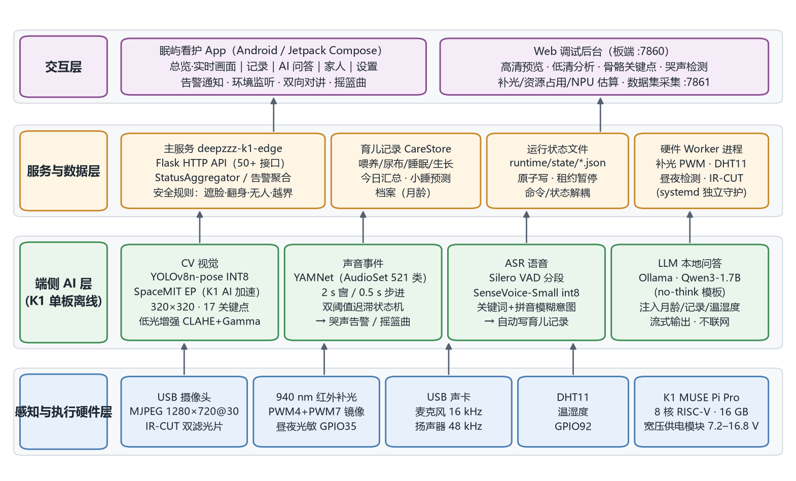

# DeepZZZ 智能婴儿看护助手

**基于 K1 MUSE Pi Pro 的边缘计算视觉无感睡眠监测与干预系统**

DeepZZZ 在一块进迭时空 **SpacemiT K1 MUSE Pi Pro**（8 核 RISC-V，16 GB）上离线运行视觉（CV）、声音事件、语音识别（ASR）和大语言模型（LLM）四类模型：发现婴儿遮脸/翻身、离开视野、越出安全区域和哭闹时主动提醒，并在本地播放摇篮曲安抚；家长说一句"宝宝换尿布了"就能自动记一笔育儿记录；板上的 Qwen3 结合宝宝月龄、当天的记录和室内温湿度回答育儿问题。画面和声音都不出家门。



## 功能

| 能力 | 实现 |
| --- | --- |
| 看得见 | YOLOv8n-pose（婴幼儿数据集迁移训练 + K1 INT8 量化，SpaceMIT EP）输出 17 个关键点 → 遮脸/翻身、无人、越界告警；光敏联动 IR-CUT + 940 nm 红外补光，可选 CLAHE + Gamma 低光增强 |
| 听得见 | YAMNet 哭声检测 + 双阈值迟滞状态机，过滤电视声、关门声等家庭噪声 |
| 能干预 | 哭声触发本地摇篮曲/白噪音；App 环境监听与双向对讲；系统通知栏推送告警 |
| 听得懂 | Silero VAD + SenseVoice-Small 本地语音识别，规则 + 拼音纠错解析"换尿布/喂奶/睡着了/醒了"，自动写入育儿记录 |
| 会回答 | Ollama + Qwen3-1.7B 本地问答，注入月龄、今日喂养/尿布/睡眠、小睡预测和温湿度，流式输出 |
| 协同调度 | CPU0–3 跑 AI 推理，主服务绑定 CPU4–7；大模型回答期间自动暂停视觉和 ASR，回答结束立即恢复 |

板端实测（演示视频中的 Web 后台画面）：姿态分析约 12 fps（320×180），画面延迟约 54 ms，YAMNet 单次推理 185 ms，整机 CPU 38.1%，内存 1.24 GB / 15.9 GB。

## 目录结构

```text
DeepZZZ/
├── K1/                         # 板端服务（部署到开发板 /home/z）
│   ├── main.py                 # 入口：Flask 主服务 :7860，数据集采集 :7861
│   ├── k1edge/                 # 类型化配置、运行时、HTTP 路由、状态存储
│   ├── ai/                     # 姿态、视觉 Worker、低光增强、YAMNet、ASR、EP 选择
│   ├── pipelines/              # 视频 / 音频流水线（摇篮曲、对讲、实时 PCM）
│   ├── services/               # 育儿记录、AI 问答、语音记录 Worker、活动区域、数据集采集
│   ├── devices/                # 摄像头、麦克风、PWM 补光、DHT11、IR-CUT、昼夜检测
│   ├── web/                    # Web 调试后台
│   ├── scripts/                # systemd 单元、模型安装、基准测试
│   ├── tests/                  # 84 个无硬件单元测试
│   ├── .brdk_models/pose/      # K1 INT8 姿态模型（3.6 MB）
│   └── models/yamnet/          # YAMNet 模型与标签
├── app/naviga/                 # 眠屿看护 Android App（Kotlin + Jetpack Compose）
└── docs/                       # 方案书、技术文档（Markdown + Word）及配图
```

## 快速开始

```bash
git clone https://github.com/FAKER798/DeepZZZ.git
```

### 板端（K1 MUSE Pi Pro，Bianbu OS）

```bash
# 1. 依赖
sudo apt install python3-opencv python3-numpy python3-flask python3-scipy \
     python3-spacemit-ort onnxruntime ffmpeg v4l-utils alsa-utils gcc python3-libgpiod

# 2. 部署代码与模型（运行用户 z，部署根目录 /home/z）
scp -r K1/. z@<板子IP>:/home/z/
ssh z@<板子IP>
cd /home/z && mkdir -p runtime/logs runtime/state
bash scripts/install_asr_models.sh          # SenseVoice-Small int8 + Silero VAD（约 240 MB）
sh scripts/create_assistant_model.sh        # 需预先安装 Ollama；生成 qwen3-*-nothink 模型

# 3. 安装并启动服务
sudo cp scripts/deepzzz-k1-edge.service scripts/voice-trigger.service \
        scripts/day-night-sync.service scripts/pwm-control.service \
        scripts/temperature-humodity.service /etc/systemd/system/
sudo systemctl daemon-reload
sudo systemctl enable --now deepzzz-k1-edge voice-trigger day-night-sync pwm-control temperature-humodity

# 4. 验证
curl http://127.0.0.1:7860/api/healthz
```

浏览器打开 `http://<板子IP>:7860/` 查看 Web 调试后台。硬件接线、配置项和故障排查见[技术文档第 4 章](docs/技术文档.md#4-部署说明)。

### App

用 Android Studio 打开 `app/naviga` 构建，或从 Releases 下载 APK。当前版本的板端地址写在 `app/naviga/app/src/main/java/com/naviga/app/BoardNetworkModels.kt`（`192.168.22.193:7860`），请把开发板设为该静态 IP，或修改后重新构建。

### 无硬件测试

```bash
cd K1
python -m unittest discover -s tests -t . -v
```

## 文档

- [方案书](docs/方案书.md)（[Word 版](docs/DeepZZZ_方案书.docx)）
- [技术文档](docs/技术文档.md)（[Word 版](docs/DeepZZZ_技术文档.docx)）：优化策略、部署说明、用户文档、接口说明、测试报告
- 板端架构细节：[K1/架构说明.md](K1/架构说明.md)、[K1/自启情况.md](K1/自启情况.md)
- 演示视频：待上传后补充链接

## 第三方组件与许可

本仓库中团队编写的源代码以 [MIT License](LICENSE) 发布。模型和第三方组件遵循各自的许可：

| 组件 | 用途 | 许可 |
| --- | --- | --- |
| Ultralytics YOLOv8（`yolov8n-pose-k1-320-int8.onnx` 由其权重迁移训练、量化得到） | 姿态估计 | AGPL-3.0 |
| YAMNet（Google） | 声音事件分类 | Apache-2.0 |
| SenseVoice-Small（FunAudioLLM，sherpa-onnx 导出版） | 语音识别 | 遵循原始模型许可 |
| Silero VAD | 语音活动检测 | MIT |
| Qwen3（阿里云通义千问） | 本地大模型问答 | Apache-2.0 |
| SpacemiT onnxruntime EP / xquant | K1 推理与量化 | 遵循进迭时空发布条款 |
