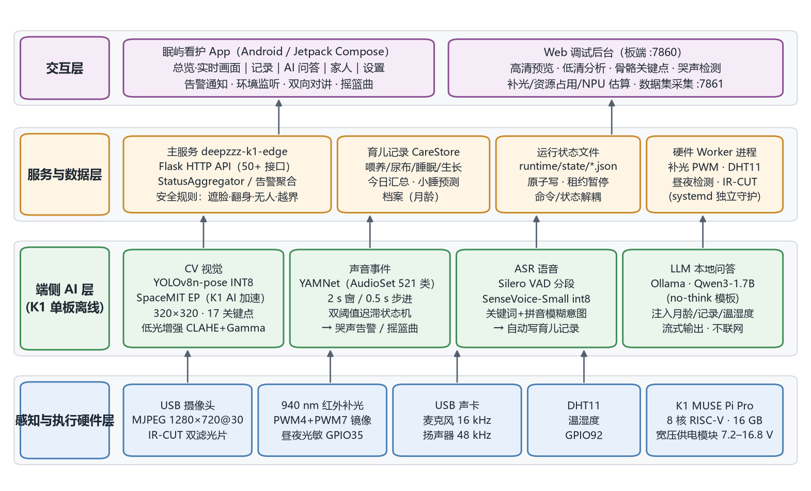
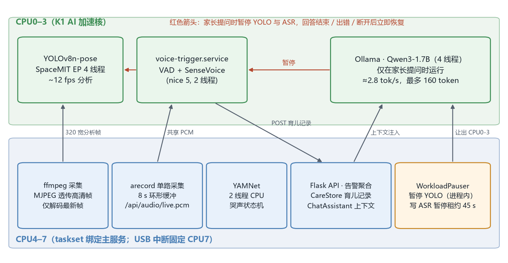
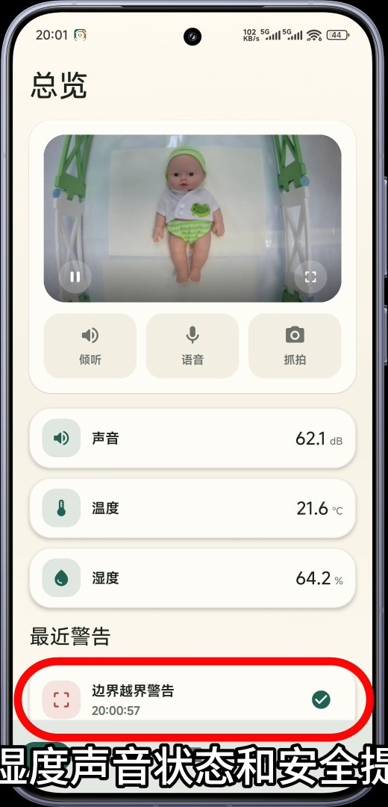
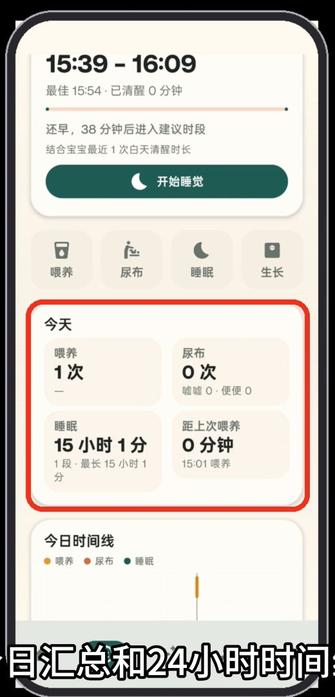
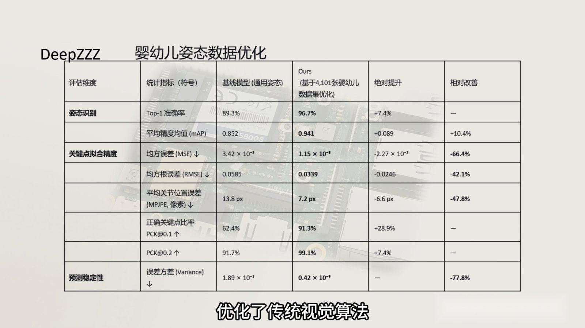
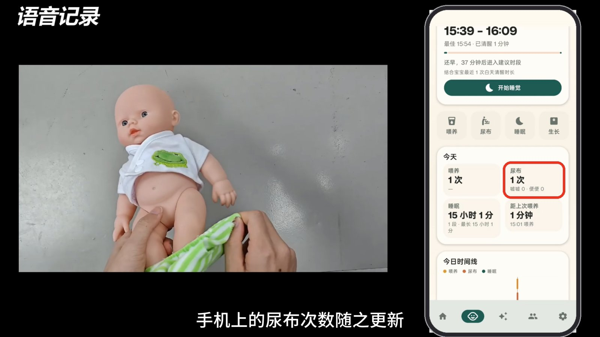

# DeepZZZ 智能婴儿看护助手 技术文档

## 优化策略 · 部署说明 · 用户文档 · 接口说明 · 测试报告

| 项目 | 内容 |
| --- | --- |
| 系统名称 | 基于 K1 MUSE Pi Pro 的边缘计算视觉无感睡眠监测与干预系统（DeepZZZ） |
| 板端版本 | `K1_board_export_20261107`（2026-11-07 从开发板 `/home/z` 导出） |
| App 版本 | 眠屿看护 `com.naviga.app` 1.0（minSdk 29 / targetSdk 36） |
| 硬件平台 | SpacemiT K1 MUSE Pi Pro，16 GB 内存，128 GB 存储，Bianbu OS |
| 推理运行时 | onnxruntime + SpaceMIT EP（`/opt/spacemit-ort/2.0.5`）；Ollama |
| 文档日期 | 2026-11-07 |

> **数据来源说明**：本文中的数据分为四类，在每处都会注明：**[实测-PC]** 在开发电脑上运行仓库代码得到；**[实测-板端]** 为演示视频中 Web 后台实录画面或板端日志；**[板端观测]** 为开发过程中在板上观察到、并记录在代码注释里的数值；**[训练实验]** 为团队模型训练实验记录。凡标注"待板端复测"的项目，本文都给出了复现命令。

---

## 1 概述

### 1.1 系统组成

DeepZZZ 由三部分组成：

1. **K1 板端服务**（本仓库 `K1/`）：在一块 K1 MUSE Pi Pro 上运行视觉姿态、哭声检测、语音识别、大模型问答和全部业务逻辑，对外提供 HTTP 接口；
2. **眠屿看护 App**（`app/naviga/`）：Android 客户端，供家长日常使用；
3. **外设硬件**：USB 摄像头（带 IR-CUT）、940 nm 红外补光套件、USB 声卡（麦克风 + 扬声器）、DHT11 温湿度传感器、光敏昼夜检测模块、自研宽压供电模块。

### 1.2 代码结构

```text
K1/
├── main.py                  # 入口：创建 AppRuntime 并启动 Flask（7860，可选 7861）
├── config.json              # 板端默认配置（含 voice_trigger 段）
├── k1edge/
│   ├── config.py            # 类型化配置：默认值 → config.json → 环境变量 → 命令行
│   ├── runtime.py           # VideoRuntime / AudioRuntime / HardwareRuntime / StatusAggregator / AppRuntime
│   ├── app.py               # Flask 主服务与数据集服务的路由
│   └── runtime_store.py     # 状态 JSON 原子读写、age/stale 判断
├── ai/
│   ├── runtime.py           # SpaceMIT EP 注册、provider 顺序与 CPU fallback 控制
│   ├── pose.py              # YOLOv8-pose 预处理 / 推理 / NMS / 骨架绘制
│   ├── vision_ai.py         # 视觉 Worker：最新帧调度、低光增强、暂停/恢复、帧率统计
│   ├── low_light.py         # CLAHE + Gamma 低光增强
│   ├── audio_ai.py          # YAMNet、哭声状态机、连续录音环形缓冲
│   └── asr.py               # 纯 numpy 的 fbank/LFR + SenseVoice CTC 解码 + Silero VAD
├── pipelines/
│   ├── video_pipeline.py    # 摄像头 → 视觉 Worker
│   └── audio_pipeline.py    # 录音、YAMNet 循环、摇篮曲播放器、对讲、实时 PCM
├── services/
│   ├── care_log.py          # 育儿记录库、今日汇总、小睡预测
│   ├── chat_assistant.py    # AI 问答：上下文构造、Ollama 流式、负载暂停
│   ├── voice_trigger.py     # 语音记录 Worker（独立进程）
│   ├── pinyin_match.py      # 拼音模糊匹配
│   ├── activity_zone.py     # 活动区域与越界判定
│   ├── dataset_capture.py   # 数据集采集
│   └── resources.py         # CPU/内存/温度/进程资源监控
├── devices/                 # camera / mic / pwm_dual / lightcontrol / temperature_humidity / day_night / ircut
├── web/                     # 调试后台（index.html、app.js、styles.css；dataset.*）
├── scripts/                 # systemd 单元、模型安装、基准测试、IR-CUT/昼夜工具
├── tests/                   # 84 个无硬件单元测试
├── .brdk_models/pose/       # K1 INT8 姿态模型
└── models/yamnet/           # YAMNet 模型与标签
```

仓库根目录另有 `app/naviga/`（App 源码）和 `docs/`（本文档、方案书及配图）。

规模：板端 Python 约 12,400 行，Web 前端约 2,300 行；App Kotlin 约 9,000 行。

### 1.3 运行时进程与端口

| 进程 / 服务 | 启动命令（摘要） | 端口 | CPU |
| --- | --- | --- | --- |
| `deepzzz-k1-edge.service` | `taskset -c 4-7 python3 /home/z/main.py` | 7860（主）、7861（数据集） | 4–7（YOLO 推理线程在 0–3） |
| `voice-trigger.service` | `taskset -c 0-3 nice -n 5 python3 services/voice_trigger.py` | — | 0–3 |
| Ollama | `ollama serve` | 11434（仅本机） | 回答时 4 线程 |
| `pwm-control.service` | `python3 pwm_control.py --frequency-hz 10000` | — | — |
| `temperature-humodity.service` | 编译 `dht11_reader.c` 后运行 `temperature_humidity.py --gpio 92` | — | — |
| `day-night-sync.service` | `day_night.py sync-ircut --sync-camera --debounce-ms 300 --interval-ms 200` | — | — |
| `deepzzz-usb-irq-affinity.service` | `/usr/local/sbin/deepzzz-pin-usb-irq` | — | USB 中断 → CPU7 |

---

## 2 系统架构与数据流



*图 1 系统总体架构*

### 2.1 视频与视觉

```text
USB 摄像头 (MJPEG 1280×720@30)
 → devices.camera.CameraPipeline：单个 ffmpeg，-f mjpeg 透传，image2pipe 输出完整 JPEG
 → 读线程只保留"最新完整 JPEG"（容量 1 的槽，旧帧被覆盖）
 → 处理线程按 analysis_fps 取最新帧：
      ├ 高清 JPEG 直接作为 /api/preview-snapshot（不重新编码）
      └ cv2 解码并缩放到 320×180 BGR → VisionWorker.submit_frame
 → VisionWorker：待处理队列 maxlen=1；暂停时直接丢帧
 → [可选] 低光增强 → YoloPoseEngine.infer（SpaceMIT EP，320×320 输入）
 → 绘制/编码放到独立线程 → latest_result / latest_jpeg
 → StatusAggregator：vision_safety（遮脸/翻身/无人）+ activity_zone（越界）→ /api/status、/api/alerts
```

### 2.2 音频与哭声

```text
arecord -f S16_LE -r 16000 -c 1（-F 10 ms 周期，-B 40 ms 缓冲）
 → ContinuousWaveformRecorder：环形缓冲 max(8 s, 3×yamnet_seconds)，带全局字节位置与条件变量
 ├ YAMNet 循环：每 0.5 s 取最近 2 s → YamnetCryDetector → CryStateTracker → latest_yamnet
 └ /api/audio/live.pcm：按字节位置增量推送（每块 ≤320 字节，即 10 ms），供 ASR Worker 与 App 监听
```

### 2.3 语音记录（ASR）

```text
voice_trigger.py（独立进程）
 → HTTP 读取 /api/audio/live.pcm → 512 采样窗口
 → SpeechSegmenter（Silero VAD，阈值 0.65 / 退出阈值 0.50，最短 0.5 s，最长 5 s，静音 0.5 s 收尾，预留 0.15 s）
 → 语音段队列（maxsize=4，满时丢弃最旧段）→ ASR 线程
 → SenseVoiceRecognizer.transcribe → CareIntentMatcher.match
 → 查询近期记录 → 新建或合并 → POST/PUT /api/care/records
 → 每秒写 runtime/state/voice_trigger.json（state、avg_asr_ms、avg_rtf、history、counters）
```

### 2.4 AI 问答（LLM）

```text
App POST /api/assistant/chat {messages:[...]}
 → ChatAssistant.prepare：校验（最后一条必须是非空用户问题，≤500 字）
 → 单请求互斥锁（忙时返回 {"type":"error","code":"busy"}）
 → build_context(CareStore.overview(), DHT11 状态) → system prompt
 → WorkloadPauser.paused()：vision.pause("assistant") + 写 voice_pause.json 租约
 → Ollama /api/chat stream → NDJSON：start(facts) → delta… → done(stats)
 → finally：关闭上游连接（停止生成）、删除租约、vision.resume()
```

### 2.5 硬件 Worker 与状态文件

主服务和硬件 Worker 之间只通过 `runtime/state/*.json` 交换命令和状态，统一由 `k1edge.runtime_store.write_json` 原子写入（先写临时文件再改名）。读取方根据 `updated_at` 计算数据年龄，超时即视为离线：

| 文件 | 写入方 | 读取方 |
| --- | --- | --- |
| `pwm_dual_command.json` / `pwm_dual_status.json` | 主服务 / PWM Worker | PWM Worker / 主服务 |
| `temperature_humidity.json` | DHT11 Worker | 主服务、AI 问答 |
| `day_night`、`current_mode` | 昼夜同步服务 | 主服务、低光增强 |
| `voice_trigger.json` / `voice_trigger_command.json` | ASR Worker / 主服务 | 主服务 / ASR Worker |
| `voice_pause.json`（租约） | AI 问答 | ASR Worker |
| `activity_zone.json` | 主服务 | 主服务 |
| `runtime/care/records.json`、`runtime/care/profile.json`（育儿记录与档案） | 主服务（App 与 ASR Worker 都经 HTTP 写入） | 主服务 |

---

## 3 优化策略与性能优化方案

### 3.1 优化目标与约束

| 约束 | 说明 |
| --- | --- |
| 算力 | 8 核 RISC-V；AI 加速推理线程集中在 CPU0–3，四类模型要分时、分核共享 |
| 实时性 | 高危状态需要在 1 s 内到达手机；画面延迟不能随运行时间累积 |
| 内存 | 16 GB，需要同时容纳 SenseVoice（239 MB）、Qwen3-1.7B、YAMNet、姿态模型和视频缓冲 |
| 软件生态 | riscv64 上原生编译 sherpa-onnx、kaldi、torch 成本高，优先使用 Bianbu 自带的 numpy / onnxruntime |
| 稳定性 | 7×24 运行，任何一个子模块故障都不能拖垮整机 |

### 3.2 视觉链路优化

| # | 优化项 | 做法 | 收益 |
| --- | --- | --- | --- |
| V1 | **K1 INT8 量化** | YOLOv8n-pose 在婴幼儿数据集上迁移训练后导出 320×320 ONNX（opset 13），用 xquant 做 INT8 校准；在 `/model.22` 后处理 Reshape 节点前截断，避免坐标解码引入量化误差 | 模型从 13.3 MB 降到 3.6 MB（−73%）；吞吐从 FP32 原型的 2.6 fps 提升到约 12 fps |
| V2 | **NPU EP 不回退 CPU** | `POSE_PROVIDER=SpaceMITExecutionProvider`，`POSE_PROVIDER_FALLBACK=0`；`SPACEMIT_EP_INTRA_THREAD_NUM=4`，ORT 自身 `intra_op_num_threads=1` | 防止模型悄悄落到 CPU 上导致帧率骤降；EP 线程与 ORT 线程不互相争抢 |
| V3 | **高清/低清分流** | 预览直接使用摄像头输出的 MJPEG 帧（1280×720，不重新编码）；分析只用 320×180 | 省掉高清帧的解码和编码开销，分析分辨率与模型输入匹配 |
| V4 | **最新帧槽，零积压** | 采集槽和推理待处理队列容量都是 1，新帧覆盖旧帧；网页/App 只拉取最新快照，不使用 HLS 或视频切片 | 画面延迟不随运行时间累积 |
| V5 | **按需解码** | ffmpeg 只负责读出 MJPEG，Python 端按分析帧率只解码最新一帧 | 解码量从 30 fps 降到分析帧率 |
| V6 | **单目标后处理** | `MAX_PERSONS=1`，过滤边长 < 5 px 的框，置信度 0.25 / IoU 0.45 NMS | 后处理开销小，避免小目标误检 |
| V7 | **推理与绘制解耦** | 骨架绘制和 JPEG 编码放在独立的解码线程（deque maxlen=1） | 推理线程不被绘制阻塞 |
| V8 | **CPU 与中断亲和** | 主服务 `taskset -c 4-7`；USB 摄像头 IRQ 固定到 CPU7 | 采集中断和 Web 线程不抢 AI 推理核 |
| V9 | **低光自适应** | `auto` 模式只在夜间或平均亮度 < 70 时启用 CLAHE + Gamma（可选去饱和） | 白天零额外开销，弱光下提升关键点置信度 |
| V10 | **摄像头自愈** | 采集停滞后自动重启 ffmpeg（代码提交 "Recover stalled camera capture automatically"），代际编号防止旧线程写入 | 长时间运行不卡死 |

**效果对比**

| 阶段 | 模型 | 运行方式 | 单帧耗时 | 帧率 | 来源 |
| --- | --- | --- | --- | --- | --- |
| 早期原型（2026-04/05） | `yolov8n-pose-320.onnx`（FP32，13.3 MB） | Ultralytics 风格脚本，SpaceMIT EP | 均值 326.7 ms（中位数 325.2 ms，57 个采样） | ~2.6 fps | [实测-板端] `pose_demo/logs/ultralytics_pose.log` |
| 当前版本 | `yolov8n-pose-k1-320-int8.onnx`（INT8，3.6 MB） | k1edge VisionWorker，SpaceMIT EP，不回退 | ≈ 83 ms（由吞吐推算，含预处理/推理/后处理） | 11.7–12.2 fps | [实测-板端] 演示视频 Web 后台 |

> 配置的分析帧率上限为 15 fps，实测稳定在约 12 fps，说明单帧处理约 80 ms 是当前的瓶颈。纯推理耗时可以用 `scripts/benchmark_pose.py --compare-cpu` 单独测量（见 7.7 节）。

### 3.3 音频链路优化

| # | 优化项 | 做法 | 收益 |
| --- | --- | --- | --- |
| A1 | **单路采集，多方共享** | 只有主服务的一个 arecord 进程打开声卡；YAMNet、ASR Worker、App 环境监听都从同一个环形缓冲按字节位置读取 | 避免多个进程争抢 ALSA 设备，三路消费互不阻塞 |
| A2 | **低延迟 ALSA 参数** | `-F 10000 -B 40000`（10 ms 周期 / 40 ms 缓冲），读块 0.25 s | 采集抖动小，实时 PCM 块 10 ms |
| A3 | **滑动窗口推理** | YAMNet 每 0.5 s 对最近 2 s 推理一次，CPU 2 线程 | 单次约 185 ms，占用可控 |
| A4 | **鲁棒的哭声分数** | 对"婴儿哭/啜泣/尖叫"三类取逐帧最大值，再取前 3 帧的均值（`top3_frame_mean`），而不是整段平均 | 短促哭声不会被静音帧稀释，单帧尖峰也不会误报 |
| A5 | **双阈值迟滞** | 分数 ≥ 0.45 进入哭闹并保持 2 s；连续 4 次 < 0.20 才退出 | 滤除关门声、电视声等瞬态噪声；告警不会来回跳 |
| A6 | **播放优先级** | 对讲开始时暂停摇篮曲并记住播放位置，结束后自动恢复 | 安抚和对讲互不干扰 |

### 3.4 ASR 优化

| # | 优化项 | 做法 | 收益 |
| --- | --- | --- | --- |
| S1 | **零原生依赖** | 自己实现与 kaldi-native-fbank 一致的 80 维 fbank（Povey 窗、预加重 0.97、snip_edges=False 的反射填充），以及 LFR(7,6) 拼帧、CMVN、CTC 贪心解码 | 只依赖 numpy + onnxruntime，在 Bianbu 上直接运行，不用编译 sherpa-onnx |
| S2 | **LFR 对齐 sherpa-onnx** | LFR 不做首尾填充（和 sherpa-onnx 一致） | 早期按 FunASR 方式做填充时，测试音频会被识别错；改成不填充后与参考转写一致 |
| S3 | **INT8 模型** | SenseVoice-Small int8 导出版（239 MB），开启逆文本正则化 | 数字直接输出为阿拉伯数字，便于抽取奶量和时长 |
| S4 | **VAD 门控** | 只把 Silero VAD 判为语音的 0.5–5 s 片段送去识别；阈值 0.65，退出阈值低 0.15（迟滞） | 环境安静时 ASR 几乎不占 CPU；片段短，识别延迟低 |
| S5 | **有界队列** | 语音段队列 maxsize=4，满时丢弃最旧的一段 | 突发说话不会造成内存与延迟累积 |
| S6 | **预热** | 模型加载后先用 1 s 静音推理一次 | 首句识别不受懒分配拖慢 |
| S7 | **进程隔离 + 降优先级** | 独立 systemd 服务，`taskset -c 0-3`，`nice -n 5`，2 线程 | 不影响主服务；与 YOLO 共用 AI 核时优先保证视觉 |
| S8 | **规则意图 + 拼音纠错** | 46 个关键词；否定/将来时/是非问句过滤；繁简转换；中文数字解析；拼音相似度（同音同调 0.95，异调 0.9，模糊韵母 0.75）阈值 0.9 | 不调用大模型，毫秒级完成意图解析；纠正"尿不时""为母乳"等常见同音错字 |
| S9 | **合并去重** | 尿布 10 min、喂养 30 min 内合并为同一条（喂养类型不同则不合并）；App 已手动记录的不再新增；睡眠自动开始和结束 | 避免家长重复唠叨产生重复记录 |
| S10 | **暂停租约** | 读取 `voice_pause.json` 的 `until` 字段，到期自动恢复 | 大模型回答期间让出 CPU；主服务崩溃也不会让 ASR 一直停着 |

### 3.5 大模型（LLM）优化

| # | 优化项 | 做法 | 收益 |
| --- | --- | --- | --- |
| L1 | **模型规模选择** | 默认 `qwen3-1.7b-nothink`，备用 `qwen3-0.6b-nothink` | 1.7B 回答质量明显更好，生成约 2.8 token/s [板端观测] |
| L2 | **强制关闭思考链** | `scripts/create_assistant_model.sh` 把 Qwen3 模板里的条件思考块替换为固定空块（该 Ollama 版本会忽略 `"think": false`） | 不生成冗长思考内容，首个 token 更早出现 |
| L3 | **修复系统提示词重复渲染** | 1.7B 的模板取自 qwen3:0.6b 的新版模板（旧版 qwen3:1.7b 导入后会渲染两次系统提示词） | 恢复 Ollama 的提示词缓存，每次提问少约 30 s 预填充 [板端观测] |
| L4 | **缓存友好的上下文顺序** | 档案、今日汇总等变化慢的内容在前，"现在时间""已清醒 X 分钟"等每分钟都变的内容放最后 | 最大化 KV 缓存前缀复用 |
| L5 | **缩小上下文窗口** | `num_ctx=2048`（提示词约 300 token） | 默认 8192 需要约 900 MB KV 缓存 [板端观测]，缩小后显著省内存 |
| L6 | **模型常驻** | `keep_alive=30m` | 避免每次提问约 11 s 的重新加载 [板端观测] |
| L7 | **限制输出与历史** | `max_tokens=160`、`temperature=0.6`、`history_turns=0` | 最坏约 1 分钟答完；避免小模型照抄上一轮回答；不增加预填充 |
| L8 | **让出 AI 核** | 回答期间暂停 YOLO（进程内）与 ASR（租约），`num_thread=4` | 大模型独占 CPU0–3 |
| L9 | **流式与可取消** | NDJSON 逐 token 推送；客户端断开时关闭生成器、关闭上游 socket，Ollama 随即停止生成 | 体感延迟低，不做无效计算 |
| L10 | **单飞控制** | 同一时刻只回答一个问题，忙时立即返回提示 | 防止排队拖垮整机 |

### 3.6 多模态协同调度



*图 2 多模态协同与 CPU 资源分区*

调度策略可以概括为三点：

1. **静态分核**：常驻的感知负载（ffmpeg、YAMNet、Flask）绑定 CPU4–7；AI 加速负载（YOLO EP、ASR）运行在 CPU0–3，ASR 用 `nice 5` 降低优先级。
2. **事件驱动让渡**：大模型属于"突发"负载，只在家长提问时运行，由 `WorkloadPauser` 临时收回 CPU0–3，回答结束立即归还。暂停期间视觉保留最后一次结果，ASR 丢弃排队的语音段，不会在恢复后集中补算。
3. **数据面共享**：视频只有一路采集、音频只有一路采集，状态统一由 `StatusAggregator` 汇总；育儿记录库同时服务 App、ASR 和大模型，三方看到的是同一份数据。

### 3.7 可靠性设计

| 机制 | 说明 |
| --- | --- |
| systemd 守护 | 主服务 `Restart=always`、`RestartSec=1`；ASR Worker `RestartSec=5` |
| 模型缺失不崩溃 | ASR 模型缺失时 Worker 进入 `error` 状态并持续上报，不反复重启 |
| 状态过期检测 | ASR 状态超过 6 s 未更新即显示离线；温湿度超过 10 min 不再注入大模型 |
| 记录校验 | 时间戳兼容秒/毫秒，拒绝超过当前时间 5 min 的未来时间；数值范围校验（奶量 0–500 ml、亲喂 0–240 min、体重 0.5–40 kg 等）；同一时间只能有一段进行中的睡眠，且不超过 24 h；记录总数上限 20000 条 |
| 告警幂等 | 告警 id 以 10 s 为桶生成，App 端可以去重和确认；同一告警 3 s 冷却后重复提醒 |
| 硬件隔离 | PWM / pinmux（需要 root）、DHT11 时序、IR-CUT 脉冲都在独立 Worker 中，主服务以普通用户 `z` 运行 |

### 3.8 优化效果汇总

| 指标 | 数值 | 来源 |
| --- | --- | --- |
| 姿态分析帧率 | 11.7–12.2 fps（320×180） | [实测-板端] 演示视频 |
| 相比 FP32 原型 | 2.6 fps → ~12 fps（约 4.6×） | [实测-板端] 日志 + 演示视频 |
| 姿态模型体积 | 13.3 MB → 3.6 MB（−73%） | 文件清单 |
| 画面延迟（帧龄） | 约 20–90 ms，典型 54 ms | [实测-板端] 演示视频 |
| 帧处理完成率 | 20760 / 20779 = 99.9% | [实测-板端] 演示视频 Device 面板 |
| YAMNet 单次推理 | 184.9 ms（2 s 窗口） | [实测-板端] 演示视频 |
| 整机 CPU / 内存 | 38.1%（8 核）/ 1237.5 MB of 15901 MB（7.8%） | [实测-板端] 演示视频（视觉 + YAMNet 运行时） |
| 主服务进程 | CPU 406.3%（约 4 核）/ RSS 216.8 MB | [实测-板端] 演示视频 |
| ASR 识别（参考） | 5.2 s 语音 95 ms，RTF 0.018 | [实测-PC] 4 线程，见 7.3 节；板端 RTF 待复测 |
| LLM 生成 | ~2.8 token/s（Qwen3-1.7B，4 线程） | [板端观测] |
| LLM 重载 / 预填充优化 | 避免 ~11 s 重载；修复模板后每问少 ~30 s；KV 缓存省 ~900 MB | [板端观测] |

---

## 4 部署说明

### 4.1 硬件清单与接线

| 外设 | 连接 | 说明 |
| --- | --- | --- |
| USB 摄像头 | USB 3.0 | `camera_device=auto` 自动查找；需支持 MJPEG 1280×720@30 |
| USB 声卡 | USB | ALSA 设备名 `plughw:CARD=UACDemoV10,DEV=0`（换声卡后修改 `AUDIO_DEVICE` / `AUDIO_OUTPUT_DEVICE`） |
| 红外补光 | PWM4：GPIO34 / 排针 32；PWM7：GPIO37 / 排针 40 | 两路镜像输出，10 kHz；由 `pwm-control.service` 以 root 运行 |
| IR-CUT | GPIO33 / GPIO46（H 桥） | `scripts/ir_cut_control.py day|night|off|status` |
| 昼夜光敏 | GPIO35 | `scripts/day_night.py status` |
| DHT11 | GPIO92（gpiochip0），上拉 | 由 `dht11_reader.c` 精确时序读取，2.5 s 周期 |
| 供电 | 宽压模块 7.2–16.8 V 输入 | 多路隔离输出给主板、补光与风扇 |

### 4.2 系统与依赖

板端系统为 Bianbu OS（riscv64），优先使用 apt 包：

```bash
sudo apt update
sudo apt install python3-opencv python3-numpy python3-flask python3-scipy \
     python3-spacemit-ort onnxruntime ffmpeg v4l-utils alsa-utils gcc python3-libgpiod
```

确认 SpaceMIT EP 可用：

```bash
bash scripts/check_board.sh
# providers 中应包含 SpaceMITExecutionProvider
```

大模型使用 Ollama。板端需预先安装 K1 可用的 Ollama（例如 Bianbu 源中的 `spacemit-ollama-toolkit`），并保证 `ollama serve` 监听 `127.0.0.1:11434`。

### 4.3 部署代码

部署根目录为 `/home/z`，运行用户为 `z`：

```bash
# 在开发机上
scp -r K1/* z@<板子IP>:/home/z/
# 在板子上
cd /home/z && mkdir -p runtime/logs runtime/state runtime/audio
```

### 4.4 准备模型

| 模型 | 放置路径 | 获取方式 |
| --- | --- | --- |
| 婴幼儿姿态 INT8 | `/home/z/.brdk_models/pose/yolov8n-pose-k1-320-int8.onnx` | 已包含在仓库 `K1/.brdk_models/pose/`（3.6 MB，SHA-256 `ee5e9192…`，与板端部署版本一致）；也可按 `official_yolov8_pipeline.md` 自行训练、量化 |
| YAMNet | `/home/z/models/yamnet/yamnet.onnx`、`yamnet_class_map.csv` | 已包含在仓库 `K1/models/yamnet/`（16.1 MB） |
| SenseVoice + Silero VAD | `/home/z/models/asr/` | `bash scripts/install_asr_models.sh`（默认走 hf-mirror.com，约 240 MB） |
| 拼音表 | `/home/z/models/asr/py_table.mb` | 板上安装 fcitx5 拼音助手后会自带一份；或从 Release 下载（0.37 MB） |
| Qwen3 | Ollama 模型库 | `sh scripts/create_assistant_model.sh`（拉取 qwen3:0.6b / qwen3:1.7b，并生成 `*-nothink` 版本） |
| 摇篮曲（可选） | `/home/z/runtime/lullabies/` | `python3 scripts/install_lullaby_library.py`（参数为 MP3 所在目录，详见 `--help`），或在 App 中上传 |

### 4.5 配置

配置优先级：**默认值 → `config.json` → 环境变量 → 命令行参数**。常用项：

| 配置 | 环境变量 | 默认/部署值 | 说明 |
| --- | --- | --- | --- |
| `port` / `dataset_capture_port` | `PORT` / `DATASET_CAPTURE_PORT` | 7860 / 7861 | 主服务 / 数据集采集 |
| `preview_size` / `preview_fps` | `PREVIEW_FPS` | 1280x720 / 30 | 高清预览 |
| `analysis_width` / `analysis_fps` | `ANALYSIS_WIDTH` / `ANALYSIS_FPS` | 320 / 15 | 分析帧 |
| `pose_model` | `POSE_MODEL` | `.brdk_models/pose/yolov8n-pose-k1-320-int8.onnx` | 姿态模型 |
| `pose_provider` / `pose_provider_fallback` | `POSE_PROVIDER` / `POSE_PROVIDER_FALLBACK` | SpaceMITExecutionProvider / 0 | 不回退 CPU |
| `low_light_mode` | `LOW_LIGHT_MODE` | off | off / auto / night / on |
| `audio_device` / `audio_output_device` | `AUDIO_DEVICE` / `AUDIO_OUTPUT_DEVICE` | UACDemoV10 | ALSA 设备 |
| `yamnet_seconds` / `yamnet_interval` | `YAMNET_SECONDS` / `YAMNET_INTERVAL` | 2 / 0.5 | 哭声检测窗口 / 步进 |
| `voice_trigger.*` | `VOICE_TRIGGER_<KEY>` | 见 `config.json` | 关键词、合并窗口、VAD 参数 |
| `assistant.*` | — | model、max_tokens、num_ctx 等 | 在 `config.json` 中加 `assistant` 段即可覆盖 |

### 4.6 安装 systemd 服务

```bash
cd /home/z
sudo cp scripts/deepzzz-k1-edge.service scripts/voice-trigger.service \
        scripts/day-night-sync.service scripts/pwm-control.service \
        scripts/temperature-humodity.service /etc/systemd/system/
sudo systemctl daemon-reload
sudo systemctl enable --now deepzzz-k1-edge voice-trigger day-night-sync pwm-control temperature-humodity
```

> 旧的 `camera-hls.service`、`camera-web.service`、`ir-cut.service` 已废弃，请不要再启用；补光使用 `pwm-control.service`（PWM4 + PWM7 镜像）。

### 4.7 部署验证

```bash
curl http://127.0.0.1:7860/api/healthz            # runtime.camera_running / vision_running 等为 true
curl http://127.0.0.1:7860/api/status | python3 -m json.tool | head -80
curl http://127.0.0.1:7860/api/voice-trigger       # state = listening
curl http://127.0.0.1:7860/api/assistant/status    # llm.ok = true
journalctl -u voice-trigger -f                      # 说"宝宝换尿布了"，应出现 heard: ... diaper:logged
```

浏览器打开 `http://<板子IP>:7860/`，应能看到高清预览、低清分析画面和骨骼关键点。

### 4.8 App 安装与连接

1. 从仓库 Releases 下载 APK 安装（或用 Android Studio 打开 `app/naviga` 构建）；
2. 手机和开发板连接同一个局域网；
3. 当前版本的板端地址写在 `BoardNetworkModels.kt` 中（`HOST = "192.168.22.193"`，端口 7860）。请把开发板设置为这个静态 IP，或修改该常量后重新构建；
4. 打开 App →「设置」→ 连接，点击"检查连接"，状态显示已连接即可。

App 构建（Windows 示例）：

```powershell
$env:JAVA_HOME="E:\ANDROIDSTDIO\jbr"; $env:ANDROID_HOME="E:\Android\Sdk"
Set-Location app\naviga; .\gradlew.bat :app:assembleRelease
```

> 项目未配置正式签名：release 包需要用 `apksigner` 自行签名后再安装；调试时也可以直接构建 `:app:assembleDebug`。

### 4.9 无硬件开发与测试

板端代码可以在普通 PC 上做无硬件测试（Python 3.10+，需要 flask、numpy、opencv-python、onnxruntime）：

```bash
cd K1
python -m compileall -q .
python -m unittest discover -s tests -t . -v
```

---

## 5 用户文档

### 5.1 快速上手

1. 把设备安装在婴儿床正上方，俯拍整个床面，接通电源；
2. 等待约 1 分钟，Web 后台和 App 显示画面即表示启动完成；
3. 在 App「记录」页填写宝宝档案（小名、出生日期、性别），AI 问答会据此计算月龄；
4. 在「总览」页框选活动区域，并在「设置」中打开需要的告警；
5. 如需哭声自动安抚，在摇篮曲页面上传或选择曲目，并打开"哭声自动播放"。

### 5.2 App 页面说明

**总览**

- 实时画面：点按全屏；下方三个按钮分别为**监听**（实时收听婴儿房声音）、**语音**（按住对讲，声音从设备扬声器播放）、**抓拍**（保存到成长相册）；
- 环境卡片：声音分贝、温度、湿度；
- 最近告警：遮脸/翻身、无人、哭声、越界，可逐条确认。告警同时以系统通知推送，App 退到后台时由前台服务保持运行；
- 活动区域：在画面上框选安全区域，婴儿任一身体关键点越出即告警；
- 摇篮曲：上传 MP3、播放/暂停/拖动进度/调节音量；"哭声自动播放"开启后，检测到哭闹自动开始播放。



*图 3 App 总览页*

**记录**

- 顶部显示睡眠状态和小睡建议（例如"还早，38 分钟后进入建议时段"），可一键开始/结束睡眠；
- 喂养（亲喂左/右/双侧与时长、瓶喂母乳/配方奶与毫升数、辅食）、尿布（湿/便/混合/干爽）、睡眠、生长（体重/身高/头围）一键记录；
- 今日汇总与 24 小时时间线；语音记录会自动出现，备注中保留原话（如"语音：宝宝换尿布了"）。



*图 4 App 记录页*

**AI 问答**

- 输入育儿问题，回答逐字显示；回答上方的标签是本次参考的设备事实（月龄、今日喂养/睡眠、室温湿度）；
- 回答期间可以点停止；"新对话"清空当前对话；
- 回答时设备会暂时暂停视觉分析和语音记录（通常不超过 1 分钟），回答结束后自动恢复。

**家人 / 设置**：家庭成员与邀请、成长相册；板端连接与告警开关。

### 5.3 语音记录口令

对着设备自然说话即可，不需要唤醒词。示例：

| 类别 | 会被记录的说法 | 自动识别的字段 |
| --- | --- | --- |
| 换尿布 | "宝宝换尿布了""换个尿不湿，拉了好多便便""尿布湿了" | 类型：湿 / 便 / 混合 / 干爽 |
| 喂养 | "冲了 120 毫升奶粉喂奶""左边亲喂了 15 分钟""给宝宝喂辅食，吃了米粉" | 方式、奶类、毫升、分钟、左右侧、辅食名称 |
| 入睡 | "宝宝睡着了""哄睡好了""开始睡觉" | 开始一段睡眠 |
| 睡醒 | "宝宝睡醒了""醒来啦""起床了" | 结束当前睡眠 |

不会被记录的说法：否定或将来时（"不用换尿布""等会再喂奶"）、是非问句（"换尿布了吗""喂奶了没"）、与育儿无关的闲聊。10 分钟内重复说换尿布、30 分钟内重复说同类喂养会合并成一条，不会重复计数。语音记录可以在 Web 后台或通过 `POST /api/voice-trigger {"enabled": false}` 关闭。

### 5.4 AI 问答使用建议

- 先填写宝宝生日，回答会更贴合月龄；
- 适合问作息和日常护理类问题，例如"宝宝现在该小睡了吗""今天奶量够不够""房间温度合适吗"；
- 助手不做诊断、不给药量；遇到发热（3 个月以下宝宝体温 ≥ 38 °C 须立即就医）、呼吸困难、持续呕吐、精神差、抽搐等情况，请立即就医或拨打 120。

### 5.5 Web 调试后台

访问 `http://<板子IP>:7860/`：

| 区域 | 内容 |
| --- | --- |
| HD Preview / Lowres Analysis / Skeleton | 高清预览、带检测框和骨架的分析画面、17 个关键点及置信度；分析画面上方有"安全区域/危险区域/清空"按钮 |
| 指标栏 | 画面延迟、画面帧率、音频延迟与频率、CPU、NPU（估算值 = 推理耗时 × 分析帧率）、内存、温湿度、昼夜 |
| Light / Audio | 补光 0 / 25 / 50 / 100%；录音外放测试 |
| Face Cover / Rollover | 面部五点可见性与判定原因 |
| Cry Detection | 哭声状态、分数、噪声分贝、Top 声音类别、YAMNet 延迟 |
| Voice Care Log | 语音记录 Worker 状态、最近听到的原话、最近一次写入的记录；开关按钮可启用/停用语音记录 |
| Device / Resources | 摄像头、帧计数、麦克风、各进程 CPU/内存 |

数据集采集页 `http://<板子IP>:7861/`：抓拍 → 人工确认/取消，用于扩充婴幼儿姿态数据集。

### 5.6 常见问题

| 现象 | 排查 |
| --- | --- |
| App 显示未连接 | 确认手机与板子在同一网段，板子 IP 与 App 中配置一致；`curl http://<IP>:7860/api/healthz` |
| 画面黑屏 / 不更新 | `journalctl -u deepzzz-k1-edge -n 50`；`v4l2-ctl --list-devices` 确认摄像头存在；采集卡死时会自动重启 |
| 帧率明显下降 | `/api/status` 中 `vision.provider` 应为 SpaceMIT；检查是否正在进行 AI 问答（期间视觉会暂停） |
| 夜间识别差 | 检查 `day_night` 是否为 night、IR-CUT 是否切换；适当提高补光亮度；可设置 `LOW_LIGHT_MODE=auto` |
| 哭声不报 / 误报 | 在 Web 后台查看 Cry score 与 Top sounds；必要时调整设备与婴儿的距离 |
| 语音不记录 | `/api/voice-trigger` 查看 state（`error` 多为模型缺失，运行 `install_asr_models.sh`）；查看 history 中的识别原文 |
| AI 问答无响应 | `/api/assistant/status` 中 `llm.status`；`ollama list` 应包含 `qwen3-1.7b-nothink` |

---

## 6 接口说明

所有接口均为 HTTP JSON（除特别说明外），返回格式为 `{"ok": true, ...}`，出错时为 `{"ok": false, "error": "..."}`。

### 6.1 状态与视觉

| 方法 | 路径 | 说明 |
| --- | --- | --- |
| GET | `/api/healthz` | 轻量健康检查：各子系统运行状态与配置摘要 |
| GET | `/api/status` | 完整状态：camera、vision、vision_safety、yamnet、audio、voice_trigger、resources、day_night、light、temperature_humidity、activity_zone、summary |
| GET | `/api/alerts` | 当前告警数组：`cry` / `no_person` / `face_cover_rollover` / `boundary`，含 `id`、`timestampMillis`、`title` |
| GET | `/api/preview-snapshot` | 最新高清 JPEG（不排队、不返回历史） |
| GET | `/api/snapshot` | 最新低清分析 JPEG（带骨架） |
| GET | `/api/detections` | 最新姿态结果（框、17 个关键点 `[x, y, conf]`、frame_size） |
| GET | `/api/vision/safety` | 遮脸/翻身判定详情 |
| GET / POST / DELETE | `/api/activity-zone` | 读取 / 设置 `{"zone":{"left","top","right","bottom"}}`（0–1 归一化）/ 清除 |
| POST | `/api/camera/start` `/api/camera/stop` `/api/vision/start` `/api/vision/stop` | 手动启停 |

### 6.2 音频

| 方法 | 路径 | 说明 |
| --- | --- | --- |
| GET | `/api/audio/live.pcm` | 实时 PCM 流（16 kHz、s16le、单声道） |
| POST | `/api/audio/yamnet` | `{"seconds":2}` 立即做一次哭声检测 |
| POST | `/api/audio/record` | `{"seconds":2}` 录音并返回电平 |
| POST | `/api/audio/playback` | 回放最近 N 秒录音（链路自检） |
| POST | `/api/audio/playback/upload` `/play` `/stop` `/volume` | 上传并播放音频、停止、音量 |
| GET | `/api/lullabies` | 曲库与播放状态 |
| POST | `/api/lullabies/upload` `/play` `/pause` `/seek` | 摇篮曲管理与播放控制 |
| POST | `/api/audio/talk/start` `/chunk` `/stop` | 对讲：App 推送 16 kHz PCM 分片到设备扬声器 |

### 6.3 育儿记录

记录结构（时间为 epoch 秒，App 乘以 1000 使用）：

```json
{
  "id": "18f3c0a1b2c3d4", "type": "feeding", "start_at": 1762500000.0, "end_at": null,
  "kind": "bottle", "milk": "formula", "amount_ml": 120,
  "side": null, "duration_min": null, "food": null,
  "weight_kg": null, "height_cm": null, "head_cm": null,
  "note": "语音：冲了120毫升奶粉喂奶", "source": "voice", "voice_text": "冲了120毫升奶粉喂奶"
}
```

| 方法 | 路径 | 说明 |
| --- | --- | --- |
| GET | `/api/care/records?type=&since=&until=&limit=` | 查询，按开始时间倒序 |
| POST | `/api/care/records` | 新建（带 id 时为幂等创建，重试不会重复） |
| GET / PUT / DELETE | `/api/care/records/<id>` | 读取 / 更新 / 删除 |
| POST | `/api/care/sleep/end` | 结束当前睡眠 |
| GET | `/api/care/overview` | 今日汇总、上次喂养/换尿布、最新生长、小睡预测 `nap` |
| GET / PUT | `/api/care/profile` | 宝宝档案 `{name, birth_date, sex}` |
| GET / POST | `/api/voice-trigger` | 语音记录 Worker 状态 / `{"enabled": true|false}` |

### 6.4 AI 问答

`POST /api/assistant/chat`，请求体：

```json
{"messages": [{"role": "user", "content": "宝宝现在该小睡了吗？"}], "stream": true}
```

响应为 `application/x-ndjson`，每行一个事件：

| type | 字段 | 说明 |
| --- | --- | --- |
| `start` | `facts` | 本次参考的设备事实标签 |
| `delta` | `text` | 增量文本 |
| `done` | `reply`、`truncated`、`elapsed_ms`、`first_token_ms`、`tokens`、`tokens_per_s`、`prompt_tokens` | 结束与性能统计 |
| `error` | `code`（`busy` / `llm`）、`error`（中文提示） | 出错 |

`"stream": false` 时一次性返回 JSON。`GET /api/assistant/status` 返回模型可用性、是否忙、上一次回答的统计数据。

### 6.5 硬件

| 方法 | 路径 | 说明 |
| --- | --- | --- |
| GET / POST | `/api/light` | 补光状态 / `{"duty": 0–100, "frequency_hz": 10000}` |
| GET | `/api/temperature-humidity` | DHT11 读数与数据年龄 |

---

## 7 测试报告

### 7.1 测试环境

| 环境 | 配置 |
| --- | --- |
| 板端 | K1 MUSE Pi Pro，16 GB / 128 GB，Bianbu OS，spacemit-ort 2.0.5，USB 摄像头 + UACDemoV10 声卡 |
| PC（无硬件测试） | Windows 11，Python 3.13，numpy 2.4.6、onnxruntime 1.31.1（CPU）、Flask 3.1.3、opencv-python 5.0 |
| 手机 | vivo V2502DA（Android），眠屿看护 1.0 |

### 7.2 单元测试 [实测-PC]

执行命令：`python -m unittest discover -s tests -t . -v`（在 `K1/` 目录，即板端导出版本 `K1_board_export_20261107`，2026-11-07）

| 测试文件 | 用例数 | 覆盖内容 |
| --- | --- | --- |
| `test_app_routes.py` | 7 | Flask 路由、状态聚合 |
| `test_camera_pipeline.py` | 4 | 摄像头命令、最新帧处理 |
| `test_care_log.py` | 9 | 记录增删改查、校验、今日汇总、小睡预测 |
| `test_chat_assistant.py` | 17 | 上下文构造、流式事件、忙控制、暂停/恢复、错误映射 |
| `test_config.py` | 2 | 配置优先级 |
| `test_pwm_dual.py` | 17 | 双路 PWM 命令/状态、sysfs 模拟 |
| `test_runtime_store.py` | 3 | 原子写、数据年龄 |
| `test_voice_trigger.py` | 25 | 意图匹配、否定/问句、数字解析、合并去重、睡眠开始/结束、拼音模糊 |
| **合计** | **84** | |

**结果**：共 84 项，**79 项通过、2 项跳过、3 项未通过**，耗时 1.35 s。

| 未通过 / 跳过项 | 原因 | 影响 |
| --- | --- | --- |
| `test_pinyin_fuzzy_matching`、`test_pinyin_table_decoding`（跳过） | PC 上没有拼音表 `py_table.mb`（板上由 fcitx5 提供，未随导出包提供） | 仅测试环境缺文件 |
| `test_questions_are_ignored`（失败） | 用例"宝宝未奶粉呢？"依赖拼音纠错（未→喂），PC 缺拼音表 | 同上；放入 `models/asr/py_table.mb` 后应通过 |
| `test_source_reader_keeps_only_the_latest_complete_jpeg`（错误）、`test_latest_source_frame_generates_both_outputs`（失败） | `CameraPipeline` 为支持采集自愈改为带 `process`、`generation` 参数，旧用例未同步更新 | 测试代码过期，需更新用例；不影响板端运行 |

### 7.3 语音识别与意图解析离线测试 [实测-PC]

使用板端同一份代码 `services/voice_trigger.py` 和同一个 SenseVoice-Small int8 模型（4 线程，CPU）：

```bash
python services/voice_trigger.py --model-dir <sense-voice目录> --threads 4 \
       --test-wav diaper_voice.wav sense-voice/test_wavs/zh.wav --benchmark 5
```

| 音频 | 时长 | 识别结果 | 耗时 | RTF | 意图 |
| --- | --- | --- | --- | --- | --- |
| `换尿布语音记录.mp3`（演示配音，转 16 kHz） | 5.25 s | 照顾宝宝时疼不开手，家长只需要说一句，宝宝换尿布了。 | 95.3 ms | 0.018 | diaper / log（关键词"换尿布"） |
| SenseVoice 官方 `zh.wav` | 5.59 s | 开饭时间早上9点至下午5点。 | 160.8 ms | 0.029 | 无（正确拒识） |

意图解析（`--test-text`）：

| 输入 | 解析结果 | 判定 |
| --- | --- | --- |
| 宝宝换尿布了 | diaper / log | ✔ |
| 冲了120毫升奶粉喂奶 | feeding：bottle、formula、120 ml | ✔ |
| 左边亲喂了15分钟 | feeding：breast、left、15 min | ✔ |
| 宝宝睡着了 / 宝宝睡醒了 | sleep_start / sleep_end | ✔ |
| 换完尿布再喂奶 | diaper + feeding 两条 | ✔ |
| 不用换尿布，还是干的 | 无 | ✔ 否定过滤 |
| 等会再喂奶 | 无 | ✔ 将来时过滤 |
| 换尿布了吗 | 无 | ✔ 问句过滤 |
| 今天天气不错 | 无 | ✔ 无关语句 |

另外，用例 `test_breast_then_formula_are_two_feedings` 回放了 **2026-11-05 17:57–18:06 在板上实际听到的 6 句话**，验证"母乳与配方奶分成两条记录、重复语句判为 duplicate、问句不记录"的合并逻辑，测试通过。

> 板端 ASR 实时率可以从 `GET /api/voice-trigger` 的 `avg_asr_ms`、`avg_rtf` 字段读取，或运行 7.7 节的命令测量（待板端复测后填入）。

### 7.4 板端性能 [实测-板端]

以下数值来自演示视频中 Web 后台的实录画面（视觉 + YAMNet 运行，2026-07-06 录制）：

| 指标 | 数值 |
| --- | --- |
| 高清预览 | 1280×720 / 30 fps |
| 分析帧率 | 11.7–12.2 fps（320×180） |
| 画面延迟 | 54 ms（演示过程中约 20–90 ms） |
| 帧计数 | 20779 captured / 20760 processed |
| YAMNet 延迟 | 184.9 ms |
| 整机 CPU | 38.1%（8 核） |
| NPU（估算） | 79.5% |
| 内存 | 1237.5 / 15901 MB（7.8%） |
| main.py | CPU 406.3%，216.8 MB |

早期原型对比（`pose_demo/logs/ultralytics_pose.log`，FP32 模型）：57 个采样平均 326.7 ms/帧、约 2.6 fps。

**大模型**（[板端观测]，记录于 `services/chat_assistant.py` 注释）：Qwen3-1.7B 约 2.8 token/s；`max_tokens=160` 时最坏约 1 分钟；`keep_alive` 避免约 11 s 重载；模板修复前每次提问额外约 30 s 预填充。每次回答的 `first_token_ms`、`tokens_per_s` 会在 `done` 事件和 `/api/assistant/status` 的 `last` 字段中返回。

> **待板端复测**：四类模型同时运行时的整机 CPU/内存、ASR 实时率、大模型首字延迟。复测方法见 7.7 节，建议复测后把结果补入本表。

### 7.5 婴幼儿姿态模型精度 [训练实验]

基于自建的 4,101 张婴幼儿姿态数据集迁移训练，对比通用姿态基线模型：

| 指标 | 基线 | Ours | 改善 |
| --- | --- | --- | --- |
| Top-1 准确率 | 89.3% | 96.7% | +7.4 pp |
| mAP | 0.852 | 0.941 | +10.4% |
| MSE ↓ | 3.42×10⁻³ | 1.15×10⁻³ | −66.4% |
| RMSE ↓ | 0.0585 | 0.0339 | −42.1% |
| MPJPE ↓ | 13.8 px | 7.2 px | −47.8% |
| PCK@0.1 ↑ | 62.4% | 91.3% | +28.9 pp |
| PCK@0.2 ↑ | 91.7% | 99.1% | +7.4 pp |
| 误差方差 ↓ | 1.89×10⁻³ | 0.42×10⁻³ | −77.8% |



*图 5 婴幼儿姿态数据优化结果（演示视频 1:17）*

### 7.6 功能测试 [实测-板端，演示视频]

| 编号 | 场景 | 操作 | 预期 | 实际结果（视频时间点） |
| --- | --- | --- | --- | --- |
| F1 | 实时画面与关键点 | 正常仰卧 | App 与网页实时显示画面；17 个关键点置信度多数 > 0.9 | ✔ 1:00，person 0.85，鼻/眼 0.97–0.98 |
| F2 | 遮脸检测 | 用纸张遮住口鼻（模拟被褥） | Face Cover 判定为疑似遮挡；App 推送"遮脸/翻身警告" | ✔ 1:28–1:33，系统通知栏与 App 内同时提示 |
| F3 | 翻身检测 | 把娃娃由仰卧翻为俯卧 | 面部关键点消失，推送翻身告警 | ✔ 1:40–1:43 |
| F4 | 危险区域 | App 框选区域，把娃娃移出边界 | 推送越界告警 | ✔ 1:47–1:52 |
| F5 | 夜间识别 | 关灯，红外补光 | 灰度红外画面中仍能输出骨架 | ✔ 1:55–2:00，person 0.63 |
| F6 | 哭声检测 | 平板播放婴儿哭声 | Cry status 变为哭闹；App 推送"哭声警告" | ✔ 2:03–2:10 |
| F7 | 自动安抚 | 开启"哭声自动播放"后触发哭声 | 设备自动播放摇篮曲 | ✔ 2:12–2:20 |
| F8 | 环境监听 / 对讲 | App 点"监听" | 手机实时听到婴儿房声音 | ✔ 2:22–2:28 |
| F9 | 育儿记录 | App 一键记录喂养 | 今日汇总与时间线更新 | ✔ 2:35–2:42 |
| F10 | 语音记录 | 家长说"宝宝换尿布了" | 尿布次数 0 → 1，备注保留原话 | ✔ 2:45–2:57 |
| F11 | AI 问答 | 提问"宝宝现在该小睡了吗？" | 显示月龄/今日记录/室温湿度标签，流式回答 | ✔ 3:00–3:12，标签"豆包 0 个月 22 天""今日喂养 0 次 · 睡眠 14 小时 56 分钟""室温 24.1°C · 湿度 43%" |



*图 6 语音记录测试（F10）*

### 7.7 复现步骤

```bash
# 1) 无硬件单元测试（PC 或板端）
cd /home/z && python3 -m unittest discover -s tests -t . -v

# 2) 姿态模型推理基准（板端；NPU 与 CPU 对比）
PYTHONPATH=/opt/spacemit-ort/2.0.5/python \
  python3 scripts/benchmark_pose.py --model /home/z/.brdk_models/pose/yolov8n-pose-k1-320-int8.onnx \
  --provider SpaceMITExecutionProvider --no-fallback --runs 50 --compare-cpu

# 3) ASR 实时率（板端，绑定 AI 核）
taskset -c 0-3 python3 services/voice_trigger.py --test-wav models/asr/sense-voice/test_zh.wav --benchmark 10

# 4) 意图解析
python3 services/voice_trigger.py --test-text "宝宝换尿布了" "冲了120毫升奶粉喂奶" "换尿布了吗"

# 5) 哭声检测单次推理
curl -X POST http://127.0.0.1:7860/api/audio/yamnet -H 'Content-Type: application/json' -d '{"seconds":2}'

# 6) 大模型首字延迟与生成速度（看最后一行 done 事件中的 first_token_ms / tokens_per_s）
curl -N -X POST http://127.0.0.1:7860/api/assistant/chat -H 'Content-Type: application/json' \
  -d '{"messages":[{"role":"user","content":"宝宝现在该小睡了吗？"}]}'

# 7) 整机资源（四模型同时运行时）
curl -s http://127.0.0.1:7860/api/status | python3 -c "import json,sys;d=json.load(sys.stdin);print(d['summary']);print(d['resources'])"
```

### 7.8 已知问题与限制

| 项目 | 现状 | 计划 |
| --- | --- | --- |
| 语音指令理解 | 当前为"关键词 + 拼音纠错 + 规则"的本地解析，未调用大模型 | 规则未命中但疑似育儿指令的语句，交给本地大模型做结构化解析 |
| 睡眠概览页 | App「睡眠」页的图表目前为示例数据 | 改为读取 `/api/care/records` 中的睡眠记录与视觉睡眠状态 |
| 家人 / 成长相册 | 邀请链接为本地演示；App 请求的 `/api/photos` 在板端尚未实现，相册使用本机抓拍 | 补齐板端相册接口；家庭多端同步（可选、加密） |
| 活动区域 | App 支持安全/危险两种模式和多点区域，板端目前按外接矩形做"越出即告警"判定 | 板端支持多边形与"进入危险区"判定 |
| 遮脸判定 | 单帧阈值判定（鼻/眼置信度 < 0.25），告警的平滑依赖 App 端冷却 | 增加多帧时序平滑，降低偶发误报 |
| App 板端地址 | 固定为 `192.168.22.193:7860` | 增加局域网发现与手动输入 |
| 单元测试 | 2 个摄像头用例未随代码更新 | 更新用例 |
| 部署清单 | `deploy/board-file-manifest.json` 未包含 `voice-trigger`、`pwm-control` 单元 | 重新生成清单 |

---

## 8 附录

### 8.1 voice_trigger 主要参数（`config.json`）

| 参数 | 值 | 说明 |
| --- | --- | --- |
| `language` | auto | SenseVoice 语言 |
| `care_types` | diaper, feeding, sleep | 启用的记录类型 |
| `fuzzy_pinyin` / `fuzzy_threshold` | true / 0.9 | 拼音纠错 |
| `diaper_merge_s` / `feeding_merge_s` | 600 / 1800 | 合并窗口（秒） |
| `threads` | 2 | ASR 线程 |
| `vad_threshold` | 0.65 | VAD 进入阈值（退出阈值 = 进入 − 0.15） |
| `min_speech_s` / `max_speech_s` / `pre_roll_s` | 0.5 / 5.0 / 0.15 | 语音段约束 |
| `save_segments` | false | 是否保存语音段（调试用） |

### 8.2 AI 问答主要参数（`AssistantSettings`）

| 参数 | 默认值 | 说明 |
| --- | --- | --- |
| `model` | qwen3-1.7b-nothink | Ollama 模型名 |
| `max_tokens` | 160 | 最大生成长度 |
| `temperature` | 0.6 | 采样温度 |
| `num_thread` | 4 | 推理线程（CPU0–3） |
| `num_ctx` | 2048 | 上下文窗口 |
| `keep_alive` | 30m | 模型常驻时长 |
| `history_turns` | 0 | 携带的历史轮数 |
| `pause_vision` / `pause_voice` | true / true | 回答期间暂停视觉 / ASR |
| `request_timeout_s` | 140 | 上游超时（App 端 150 s） |

### 8.3 小睡预测清醒窗口表（`care_log.WAKE_WINDOWS`）

| 月龄 ≤ | 0 | 1 | 2 | 3 | 4 | 6 | 8 | 11 | 14 | 18 | 24 | > 24 |
| --- | --- | --- | --- | --- | --- | --- | --- | --- | --- | --- | --- | --- |
| 清醒时长（分钟） | 35–60 | 45–75 | 60–90 | 75–105 | 90–135 | 120–180 | 150–210 | 180–240 | 180–270 | 240–330 | 300–360 | 300–390 |

预测方法：取近 7 天白天（7:00–19:00 醒来）15 分钟–8 小时之间的清醒间隔中位数（限制在月龄范围的 0.7–1.3 倍之间），与月龄目标按样本数加权（满 5 个样本后完全采用历史值）；建议时间窗为"最近一次醒来时间 + 目标时长 ± max(15 分钟, 月龄范围的一半)"。

### 8.4 术语

| 术语 | 含义 |
| --- | --- |
| SpaceMIT EP | 进迭时空为 onnxruntime 提供的执行器（Execution Provider），使用 K1 的 AI 扩展算力推理 |
| xquant | 进迭时空的模型量化工具（x86 上运行） |
| RTF | 实时率 = 识别耗时 / 音频时长，越小越快 |
| VAD | 语音活动检测 |
| LFR | 低帧率拼帧（SenseVoice 输入特征） |
| PCK@α | 关键点与真值的距离小于 α 倍参考尺度的比例 |
| MPJPE | 关键点平均位置误差（像素） |
| NDJSON | 每行一个 JSON 的流式格式 |
