# 基于 K1 MUSE Pi Pro 的边缘计算视觉无感睡眠监测与干预系统

## ——DeepZZZ 智能婴儿看护助手 方案书

| 项目 | 内容 |
| --- | --- |
| 项目名称 | 基于 K1 MUSE Pi Pro 的边缘计算视觉无感睡眠监测与干预系统（DeepZZZ 智能婴儿看护助手） |
| 参赛方向 | K1 端侧多模态协同：CV（视觉）+ ASR（语音识别）+ LLM（大语言模型） |
| 硬件平台 | 进迭时空 SpacemiT K1 · MUSE Pi Pro 开发板（8 核 RISC-V，16 GB 内存，128 GB 存储） |
| 配套软件 | 板端服务 DeepZZZ K1 Edge（Python）+ 手机 App「眠屿看护」（Android） |
| 开源地址 | 见附录 A |
| 文档日期 | 2026 年 11 月 |

---

## 一、摘要

年轻父母照看 0–3 岁婴幼儿时，最怕的是夜间睡眠中的意外：口鼻被被褥遮挡、翻身趴睡、爬出安全区域，以及长时间哭闹无人回应。市面上的婴儿监视器大多只是"会联网的摄像头"：要靠家长自己盯画面，视频要上传云端，智能功能要订阅付费，断网就不能用。

本项目在一块 **K1 MUSE Pi Pro** 开发板上实现了一套**完全离线**的婴儿看护系统。我们没有把几个模型简单地摆在一起，而是让**看得见（CV）、听得懂（ASR）、会回答（LLM）**三种能力在同一块板上**共用一路采集、共用一个记录库、分时共用同一组 AI 核**，串成三条闭环（图 2）：

- **安全闭环：看 + 听 → 统一告警 → 本地安抚。** 针对婴幼儿迁移训练、并量化为 K1 专用 INT8 的 **YOLOv8n-pose** 跑在 SpaceMIT 执行器（K1 AI 加速）上，实时输出 17 个人体关键点，判断**遮脸/翻身、无人、越出安全区域**；**YAMNet** 配合双阈值迟滞状态机识别婴儿哭声，滤掉电视声、关门声。视觉和声音的结果进入**同一个告警流**推送到手机，哭声还能触发板载扬声器自动播放摇篮曲。夜间由光敏传感器联动 **IR-CUT 与 940 nm 红外补光**，视觉照常工作。
- **认知闭环：看见 + 听懂 → 事件与记录 → 大模型。** 主服务每秒把视觉姿态（仰卧/侧躺/俯卧）、离开画面、越界和哭声整理成带开始时间、结束时间和持续时长的**事件**；**SenseVoice-Small** 与 YAMNet 读取同一路麦克风数据，家长随口说"宝宝睡着了""宝宝喝奶了，喝了 120 毫升奶粉"，系统在本地识别后写入育儿记录。家长向板上的 **Qwen3-1.7B** 提问时，模型同时拿到**摄像头当前画面、近 2 小时的视觉与哭声事件、语音生成的育儿记录**和室内温湿度。板端实测中，回答卡片带着"画面：画面无人 · 近 2 小时哭闹 0 次 · 遮脸/翻身 3 次"这样的事实标签；画面疑似遮脸或侧躺时，上下文会要求模型先提醒家长查看宝宝。**摄像头看到的、麦克风听到的、家长说出口的，都直接成了大模型回答的依据。**
- **算力闭环：大模型与视觉、ASR 分时共享 CPU0–3。** 大模型只在家长提问时运行：回答期间暂停 YOLO，给 ASR 下发 45 s 暂停租约，把 4 个 AI 核让给大模型；回答结束、出错或手机断开时立即归还。YAMNet 运行在 CPU4–7 上，回答期间哭声检测不中断。

画面、声音和育儿记录都只在家庭局域网内处理和保存，断网也能用。

演示视频中录到的板端实测数据为：姿态分析约 **12 fps**（320×180 分析帧），画面延迟约 **54 ms**，YAMNet 单次推理约 **185 ms**，整机 CPU 占用 **38.1%**，内存仅用 **1.24 GB / 15.9 GB**；与早期在同一块板上直接跑 FP32 模型的原型（约 327 ms/帧、2.6 fps）相比，视觉吞吐提升约 **4.6 倍**；带视觉事实的板端问答首字 **10.9–11.8 s**、生成 **2.8–2.9 token/s**。我们还在 PC 上用仓库代码完整回放了"语音 → 记录 → 大模型上下文"这条链路：5 句语音的识别耗时为 56–149 ms/句（2 线程，与板端配置相同），意图解析加写入记录不超过 3.2 ms，构造大模型上下文并完成暂停与恢复只需 4–6 ms。

**关键词**：K1 RISC-V；端侧 AI；三模态联动；婴儿睡眠监测；YOLOv8-pose；YAMNet；SenseVoice；Qwen3；隐私保护

---

## 二、引言

### 2.1 背景：不敢生、带不动

我国出生人口持续走低，2024 年全年出生人口为 954 万人[1]。阻碍年轻人生育的除了经济成本，还有照护精力的透支：在一项生育意愿调查中，62.1% 的受访者把"无人帮助带孩子"列为主要顾虑，仅次于"生育养育成本高"（86.4%）[2]。0–3 岁婴幼儿睡眠时间长、夜间需要频繁照看，家长长期睡不好；双职工家庭还经常要老人帮忙或请人照看，家长对"孩子现在怎么样"有持续的焦虑。

我们认为年轻家庭需要的是**切实可行的减负工具**：不用一直盯着屏幕，出现危险时设备能主动提醒、先做安抚；家长手上腾不开时，说一句话就能完成记录；有育儿疑问时，能得到结合宝宝当天实际情况的建议。

### 2.2 现有方案的不足

| 痛点 | 常见婴儿监视器 | 本项目 |
| --- | --- | --- |
| 危险要靠家长自己看出来 | 多为移动侦测、声音分贝阈值，误报多 | 关键点级姿态分析：遮脸/翻身、无人、越界分别告警 |
| 夜间看不清 | 只靠红外成像，算法常失效 | 光敏联动 IR-CUT + 940 nm 无红曝补光 + 低光增强后再推理 |
| 哭声误报 | 分贝阈值，电视声、关门声也报警 | YAMNet 语义分类 + 双阈值迟滞平滑 |
| 只报警，不干预 | 需要家长赶到现场 | 本地自动播放摇篮曲/白噪音，App 远程对讲 |
| 育儿记录全靠手动 | 需单独 App 手动填写 | 语音一句话自动记录，和 App 记录合并去重 |
| 隐私与可用性 | 视频上传云端，断网失效，订阅收费 | 全部模型在板上离线运行，数据不出家门 |

### 2.3 项目目标

1. 在 K1 单板上，用纯离线算力让 **CV、声音事件、ASR、LLM 四类模型同时稳定运行**；
2. 用**关键点级的视觉规则**覆盖婴儿睡眠中最危险的几种状态，并在弱光环境下可用；
3. 让三种能力真正联动起来：打通"**看 + 听 → 告警 → 本地安抚**"和"**看见 + 听懂 → 事件与记录 → 大模型问答**"两条数据闭环，并让大模型与视觉、ASR **分时共享 AI 核**；
4. 提供家长好用的手机 App 和便于调试验证的 Web 后台，保证评委可以复现。

---

## 三、技术实现

### 3.1 系统总体架构

系统分为四层：感知与执行硬件层、端侧 AI 层、服务与数据层、交互层（图 1）。所有 AI 推理都在 K1 板上完成，手机 App 通过家庭局域网访问板端的 HTTP 接口。

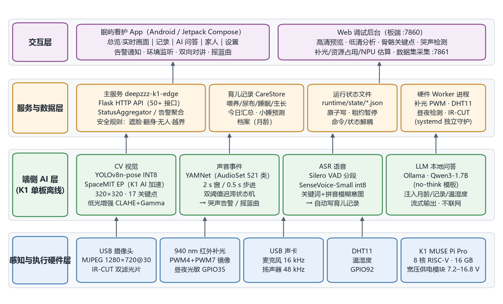

*图 1 系统总体架构*

板端由若干 systemd 服务组成，互相解耦，各自守护：

| 服务 | 职责 | CPU 绑定 |
| --- | --- | --- |
| `deepzzz-k1-edge.service` | 主服务：摄像头/视觉/音频流水线、YAMNet、育儿记录、AI 问答、HTTP API（端口 7860，数据集采集 7861） | `taskset -c 4-7`（YOLO 推理线程在 CPU0–3） |
| `voice-trigger.service` | 语音记录 Worker：VAD + SenseVoice + 意图匹配 | `taskset -c 0-3`，`nice 5` |
| Ollama | 本地大模型服务 Qwen3-1.7B（no-think 定制模板） | 回答时 4 线程，占用 CPU0–3 |
| `pwm-control` / `light-pwm.service` | 红外补光 PWM 输出（PWM4 + PWM7 镜像，10 kHz） | — |
| `temperature-humodity.service` | DHT11 温湿度读取（GPIO92，C 语言精确时序） | — |
| `day-night-sync.service` | GPIO35 光敏昼夜检测，联动 IR-CUT 与摄像头饱和度 | — |
| `deepzzz-usb-irq-affinity.service` | 把 USB 摄像头中断固定到 CPU7 | — |

> 设计原则：主服务**不直接操作** PWM sysfs、GPIO 引脚复用和 DHT11 时序，只写命令文件、读状态文件。硬件 Worker 崩溃不会拖垮 AI 主服务，反过来也一样。

### 3.2 三模态联动设计

三种能力各有分工：**CV 负责"看"**宝宝的姿态和位置，**ASR 负责"听懂"**家长说的话，**LLM 负责"回答"**家长的问题；YAMNet 哭声检测是"听"的另一半，与 ASR 共用一路麦克风。它们不是各干各的，而是通过三种共享连在一起：

1. **共享采集**：摄像头只有一路 ffmpeg 采集，麦克风只有一路 arecord 采集。同一段声音同时送给 YAMNet（判断是不是哭声）和 SenseVoice（听懂说了什么）。
2. **共享数据**：视觉告警和哭声告警进入同一个告警流；视觉姿态和哭声每秒写入同一份事件记录；语音记录、App 手动记录和大模型的上下文用的是同一个育儿记录库；`/api/status` 用一份快照同时给出视觉、哭声、ASR、温湿度和昼夜状态。
3. **共享算力**：YOLO、ASR 和大模型都使用 K1 的 AI 核 CPU0–3，由调度机制按需分时使用。

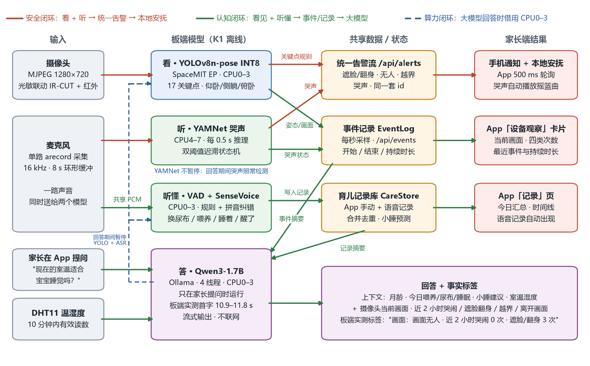

*图 2 三模态联动：安全闭环、认知闭环与算力闭环*

#### 3.2.1 联动一览

下表列出系统中已经实现的全部跨模态联动，每一项都给出代码位置和验证依据：

| # | 联动 | 实现方式（代码位置） | 验证依据 |
| --- | --- | --- | --- |
| ① | **看 + 听 → 统一告警** | `AppRuntime.alerts()` 把 YAMNet 哭声与视觉的遮脸/翻身、无人、越界合并成一个告警列表（`/api/alerts`），id 统一按 10 s 分桶；App 每 500 ms 拉取一次并推送系统通知 | 演示视频 1:28–1:52、2:03–2:10（功能测试 F2–F4、F6） |
| ② | **听 → 本地安抚** | App 打开"哭声自动播放"后，哭声告警触发板端摇篮曲；连续 2 次轮询无哭声才复位；家长对讲时摇篮曲自动让位，对讲结束后恢复 | 演示视频 2:12–2:20（F7） |
| ③ | **一路声音 → 两个模型** | 主服务中的 `ContinuousWaveformRecorder` 是唯一的麦克风采集；YAMNet 取最近 2 s 窗口，ASR Worker 通过 `/api/audio/live.pcm` 按字节位置增量读取同一个缓冲 | `pipelines/audio_pipeline.py`、`services/voice_trigger.py` |
| ④ | **听懂 → 育儿记录** | 语音 Worker 识别出换尿布/喂养/入睡/睡醒后，通过 `POST /api/care/records` 写入记录（来源标记 `voice`，原话写入备注）；与 App 手动记录合并去重 | 演示视频 2:45–2:57（F10）；PC 端到端回放；单元测试 |
| ⑤ | **育儿记录 → 大模型** | `build_context()` 从同一个记录库读取月龄、今日喂养/尿布/睡眠、上次喂养与换尿布时间、"正在睡/已清醒多久"和小睡预测，写入系统提示词；本次用到的事实以标签形式返回 App | 演示视频 2:58–3:13（F11）；PC 端到端回放；单元测试 |
| ⑥ | **环境 → 视觉 / 大模型** | 光敏模块联动 IR-CUT 与 940 nm 补光；低光增强模块读取同一个昼夜状态（`auto`/`night` 模式下夜间自动启用，当前部署以红外补光为主）；DHT11 温湿度（10 分钟内的有效读数）写入大模型上下文 | 演示视频 1:55–2:00（F5）、2:58–3:13（F11） |
| ⑦ | **大模型 ↔ 视觉 / ASR 算力** | `WorkloadPauser` 在回答期间暂停 YOLO（进程内）并给 ASR 写 45 s 暂停租约（每 15 s 续约），回答结束、出错或手机断开时立即恢复；YAMNet 不暂停 | 单元测试 6 项；PC 端到端回放 |
| ⑧ | **看 + 听 → 醒/睡状态** | Web 后台把"人体框 1 s 内位移超过 25 px""遮脸""哭声"三路信号合并判断，任一成立即显示 awake，否则显示 asleep | `web/static/app.js` |
| ⑨ | **看 + 听 → 事件记录** | 主服务的 `event-log` 线程每秒读取最近一次姿态结果和 YAMNet 状态（`k1edge/runtime.py` 的 `event_inputs()`），`EventLog`（`services/event_log.py`）把遮脸/翻身（含侧躺）、离开画面、越界、哭闹整理成事件：持续 2 s 才算开始（离开画面 5 s，哭声立即），连续 5 s 不成立才算结束（哭声 3 s），30 s 内再次出现视为同一次；记录开始/结束时间、持续时长、哭声峰值和翻身前的姿态，通过 `/api/events`、`/api/events/summary` 提供给 App「设备观察」卡片 | 演示视频 3:13–3:47（F12）；单元测试 14 项 |
| ⑩ | **事件 → 大模型** | 每次提问前读取近 2 小时的事件摘要和摄像头当前状态，`event_context()` 写入两行上下文（当前画面；各类事件次数、最近一次的开始时间和持续时长），并在 App 回答卡片上显示"画面：…"事实标签；画面疑似遮脸或侧躺时，上下文要求模型先提醒家长查看宝宝 | 演示视频 2:58–3:13（F11，板端实测标签）；单元测试 |

#### 3.2.2 一次完整的联动过程（PC 端到端回放）

为了验证"说一句话 → 记录 → 大模型上下文"这条链路，我们在 PC 上用仓库中的板端代码回放了一段完整过程：语音来自演示视频的配音片段和 Windows 中文 TTS 合成的语音，**全部经过 SenseVoice-Small 识别**，再经过意图解析、育儿记录库、小睡预测和上下文构造，与板上运行的是同一份代码。为了让一段睡眠能持续 75 分钟，时钟使用模拟时钟；温湿度用演示视频中的读数作为输入；PC 上没有运行 Qwen3，回放记录的是实际发给 Ollama 的上下文。

| 时间 | 家长说的话（SenseVoice 识别结果） | 系统动作 |
| --- | --- | --- |
| 12:58 | "……家长只需要说一句，宝宝换尿布了。" | 新建尿布记录 |
| 13:03 | "宝宝喝奶了，喝了120毫升奶粉。" | 新建喂养记录：瓶喂、配方奶、120 ml |
| 13:10 | "宝宝睡着了。" | 开始一段睡眠 |
| 13:40 | （家长在 App 提问）"宝宝睡了多久了？" | 暂停 YOLO、写入 ASR 暂停租约 → 构造上下文 → 回答结束后恢复 |
| 14:25 | "宝宝醒了。" | 结束这段睡眠（1 小时 15 分钟） |
| 14:40 | "不用换尿布，还是干的。" | 否定句，不记录 |
| 14:45 | （家长在 App 提问）"宝宝现在该小睡了吗？" | 上下文给出小睡建议时间窗 14:57–15:27 |

13:40 提问时，大模型收到的设备上下文如下（程序原样输出）：

```text
豆包，出生 2026-10-16，现在 0 个月 22 天。
注意：宝宝不满 3 个月，只要发热（体温 38°C 及以上）就要立即就医，不要在家自行降温或喂水。
今天的记录：喂养 1 次，瓶喂共 120 ml，尿布 1 次（湿 0、便 0），睡眠 30 分钟。
上次喂养在 13:03（瓶喂 配方奶 120 ml）。
上次换尿布在 12:58。
现在时间 13:40。
宝宝正在睡，13:10 入睡，已睡 30 分钟。
房间：室温 24.1°C，湿度 43%。
```

到 14:45 再提问时，倒数第二行变成"宝宝已清醒 20 分钟，按记录预测建议在 14:57-15:27 之间小睡。"这个时间窗是由"宝宝醒了"这句话的时间，加上月龄对应的清醒时长计算出来的。上下文里的喂养、尿布、睡眠信息全部来自家长说的话，家长提问时不用再把情况描述一遍。

回放结果（3 次运行）：语音识别 56–149 ms/句（SenseVoice-Small int8，2 线程，与板端配置相同）；意图解析加写入记录不超过 3.2 ms；构造上下文并完成暂停与恢复 4–6 ms。提问期间 YOLO 处于暂停状态，ASR 暂停租约存在（45 s）；回答结束后两者都已恢复，租约文件已删除。以上为 PC 数据，测试方法和完整数据见《技术文档》7.7 节。

#### 3.2.3 板端实测：看见的画面进入大模型

演示视频 2:58–3:47 的手机录屏来自开发板上的实际运行（图 3）：

- **设备观察**（图 3 a–c）：「AI 问答」页的设备观察卡片显示当前画面和近 2 小时四类事件的次数。遮住口鼻后刷新，当前画面变为"疑似遮脸/翻身"，遮脸/翻身次数从 2 次变为 3 次，并新增一条"00:12 遮脸/翻身 · 仍在持续"；移开遮挡后，画面恢复"面部可见"，这条事件结束并记下"持续 18 秒"。
- **带视觉事实的问答**（图 3 d）：家长提问"现在的室温适合宝宝睡觉吗？"，回答卡片顶部依次显示本次写入上下文的事实："豆包 0 个月 23 天""今日喂养 0 次 · 睡眠 0 分钟""画面：画面无人 · 近 2 小时哭闹 0 次 · 遮脸/翻身 3 次""室温 22.2°C · 湿度 47%"。**档案与育儿记录、摄像头与麦克风的观察、温湿度传感器读数在同一次推理中汇合**，模型据此回答"目前室温 22.2°C，属于适宜的温度范围，但要注意保持室内通风，避免过冷。……"

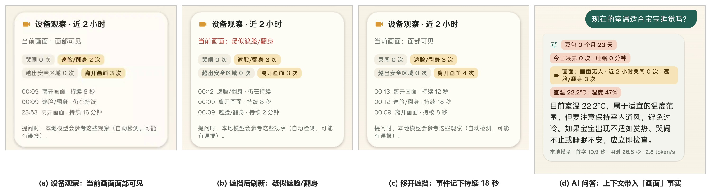

*图 3 板端实测：设备观察卡片（a–c）与带视觉事实的 AI 问答（d）*

同一段录屏中三次提问的板端计时（App 回答卡片底部显示）：

| 问题 | 首字 | 用时 | 生成速度 |
| --- | --- | --- | --- |
| 今天的奶量够不够？ | 11.5 s | 23.4 s | 2.9 token/s |
| 现在的室温适合宝宝睡觉吗？ | 10.9 s | 26.8 s | 2.8 token/s |
| 什么时候开始加辅食？ | 11.8 s | 34.7 s | 2.8 token/s |

#### 3.2.4 设计取舍：快路径守安全，慢路径做理解，事件记录连接两者

联动不等于什么都交给大模型来判断。

- **安全判断走快路径。** 视觉每帧约 83 ms，哭声每 0.5 s 判断一次，规则结果直接进入告警流，App 每 500 ms 拉取一次，设计目标是 1 s 内提醒到手机。规则可以解释、阈值可以调整，结果不受大模型生成速度的影响。
- **理解和建议走慢路径。** Qwen3-1.7B 在 K1 上首字约 11 s、生成约 2.8 token/s。如果告警要等大模型判断，危险提醒会被拖慢几十秒。所以大模型不放在告警链路上，而是在家长提问时，读取快路径沉淀下来的观察来回答。
- **事件记录把两条路径接起来。** 快路径每秒产生的姿态和哭声结果，经事件记录整理成"发生了什么、什么时候、持续多久"；语音写入的育儿记录和传感器读数同样汇总进来。慢路径提问时一次读取这些摘要：告警不必等大模型，大模型也不会错过告警。
- **算力按需流动。** 事件摘要在暂停 YOLO 之前读取，保证上下文里是最新的画面状态；随后大模型向快路径借用 AI 核，同时保留 YAMNet 持续监听哭声，回答结束立即归还。

### 3.3 硬件系统

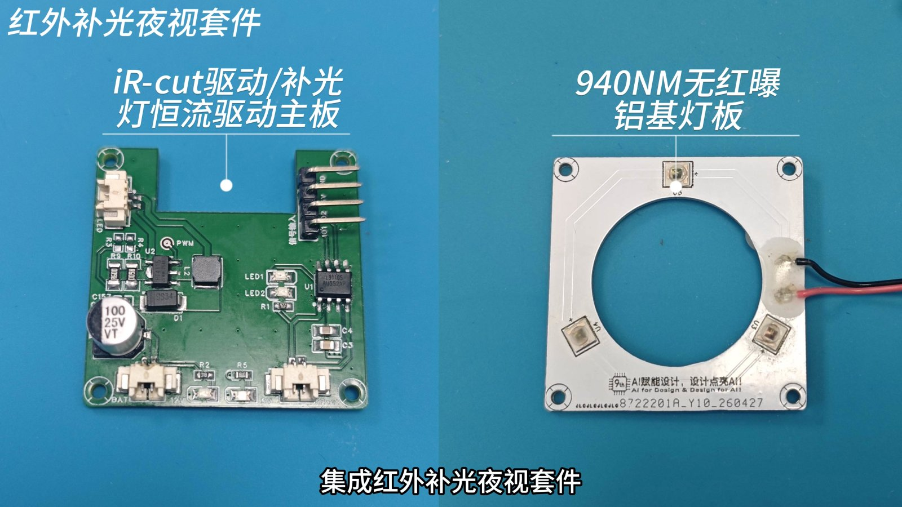

*图 4 红外补光夜视套件*

| 模块 | 型号/参数 | 作用 |
| --- | --- | --- |
| 主控 | SpacemiT K1 MUSE Pi Pro，8 核 RISC-V，16 GB LPDDR4X，128 GB 存储，Bianbu OS | 全部 AI 推理与业务服务 |
| 摄像头 | USB UVC 摄像头，MJPEG 1280×720@30 fps，带 IR-CUT 双滤光片 | 视频采集 |
| 夜视套件 | 自研 IR-CUT 驱动/补光恒流驱动板 + 940 nm 无红曝铝基灯板 | 夜间红外补光，不刺激婴儿 |
| 昼夜检测 | 光敏模块 → GPIO35；IR-CUT H 桥 → GPIO33/GPIO46 | 自动切换日/夜模式 |
| 音频 | USB 声卡（UACDemoV10）+ 麦克风 + 扬声器 | 哭声检测、语音识别、摇篮曲、对讲 |
| 温湿度 | DHT11 → GPIO92 | 环境监测，供告警与大模型参考 |
| 供电 | 自主设计打样的混合电压宽压供电模块，7.2–16.8 V 输入，多路隔离输出 | 保证整机稳定运行 |
| 结构 | 3D 打印外壳 + 散热风扇，俯拍支架 | 固定机位，俯视婴儿床 |

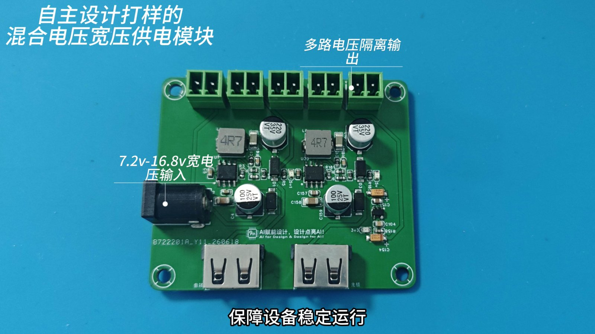

*图 5 自主设计的混合电压宽压供电模块*

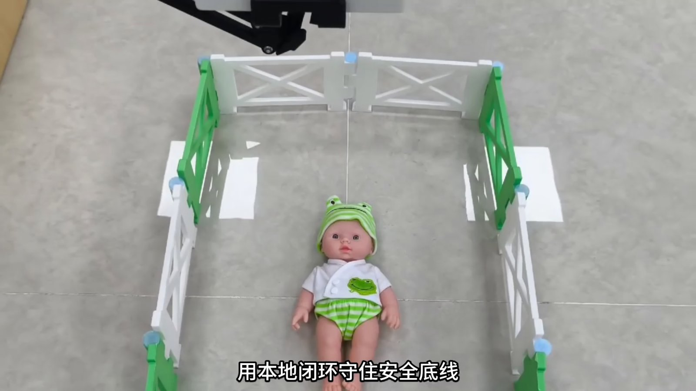

*图 6 整机部署*

### 3.4 视觉感知（CV）：看得见

#### 3.4.1 零积压的视频链路

```text
USB 摄像头 (MJPEG 1280×720@30)
  → 单个 ffmpeg 进程只负责把 MJPEG 帧从设备读出来
  → Python 容量为 1 的"最新帧槽"（新帧到来立即覆盖旧帧）
     ├─ 高清预览：MJPEG 原样透传给 App/网页，不重新编码
     └─ 分析帧：按分析帧率只解码槽里最新的一帧，缩放到 320×180
  → VisionWorker（待处理队列长度 1，旧帧直接丢弃，不形成积压）
  → YOLOv8n-pose（SpaceMIT EP）→ 关键点 + 安全规则 → /api/status、告警
```

这样设计，延迟不会随时间累积：网页实测画面延迟在 24–89 ms 之间（演示画面中常见值 54 ms），录制期间累计采集 20779 帧、分析 20760 帧，99.9% 的帧都被及时处理。

#### 3.4.2 婴幼儿姿态模型定制

通用 COCO 姿态模型是在成人数据上训练的。婴儿身体比例特殊（头大、四肢短）、常被被褥遮挡、多为俯拍视角，直接使用识别不准。我们的做法是：

1. **自建数据集**：板端提供独立的数据集采集服务（端口 7861），可以在真实部署场景中抓拍并人工确认样本，共构建了 **4,101 张**婴幼儿姿态图像；
2. **迁移训练**：以 YOLOv8n-pose 为基础模型，在自建数据集上迁移训练；
3. **K1 量化部署**：导出 320×320 ONNX，用进迭时空 xquant 工具链做 INT8 量化校准（在后处理节点前截断，避免坐标解码引入量化误差），得到 K1 专用模型 `yolov8n-pose-k1-320-int8.onnx`，体积从 FP32 的 13.3 MB 降到 **3.6 MB**。

团队迁移训练实验结果如下（基线为通用姿态模型）：

| 评估维度 | 指标 | 基线模型（通用姿态） | Ours（4,101 张婴幼儿数据集优化） | 改善 |
| --- | --- | --- | --- | --- |
| 姿态识别 | Top-1 准确率 | 89.3% | **96.7%** | +7.4 个百分点 |
| | mAP | 0.852 | **0.941** | +10.4% |
| 关键点拟合精度 | MSE ↓ | 3.42×10⁻³ | **1.15×10⁻³** | −66.4% |
| | RMSE ↓ | 0.0585 | **0.0339** | −42.1% |
| | MPJPE（像素）↓ | 13.8 px | **7.2 px** | −47.8% |
| | PCK@0.1 ↑ | 62.4% | **91.3%** | +28.9 个百分点 |
| | PCK@0.2 ↑ | 91.7% | **99.1%** | +7.4 个百分点 |
| 预测稳定性 | 误差方差 ↓ | 1.89×10⁻³ | **0.42×10⁻³** | −77.8% |

#### 3.4.3 安全规则：从关键点到告警

模型每帧输出 1 名主要人体的检测框和 17 个关键点（含置信度）。板端在关键点之上做规则判断，每条结论都能追溯到具体关键点，便于解释和调试：

| 告警 | 判定逻辑（板端实现） | 意义 |
| --- | --- | --- |
| **遮脸 / 翻身** | 鼻子、双眼关键点置信度都低于 0.25 时判为面部不可见；只剩耳朵可见时提示"疑似翻身"，没有任何面部点可见时提示"疑似遮脸" | 口鼻被被褥遮挡、由仰卧转为高危趴睡 |
| **无人** | 画面中没有检测到婴儿 | 婴儿离开监护范围或被完全遮挡 |
| **越界** | 家长在 App 上框选活动区域；任一可信身体关键点（置信度 ≥ 0.25）越出该区域即触发 | 爬出床垫、靠近床沿等危险边界 |

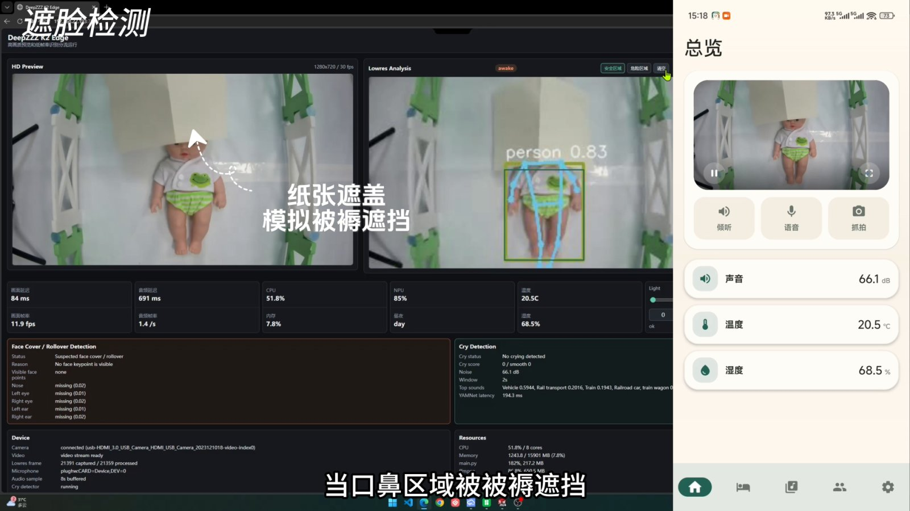

*图 7 遮脸检测*

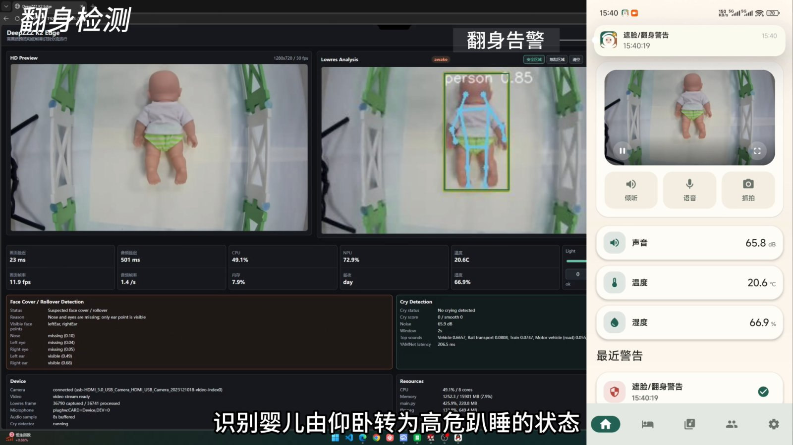

*图 8 翻身检测*

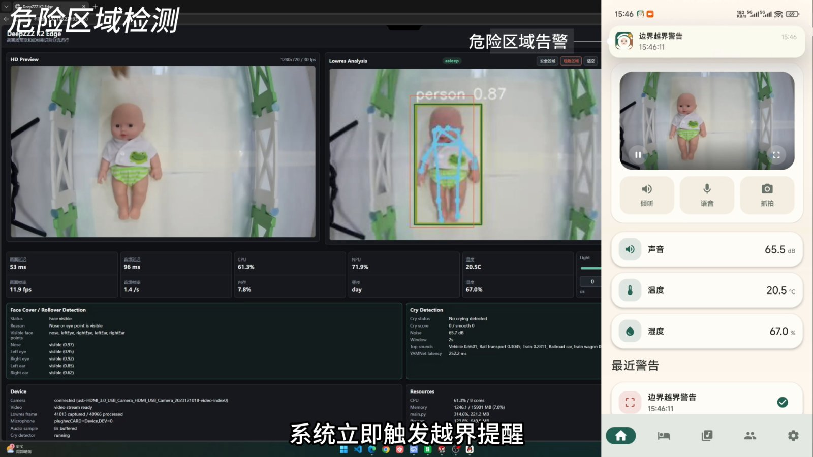

*图 9 危险区域检测*

**姿态判断（事件记录）**：除了上面的告警规则，事件记录还判断宝宝当前的睡姿。俯视时，仰卧宝宝两肩的宽度约为肩到胯距离的 0.8–1.0 倍；侧躺时两肩上下重叠，这个比值明显下降。比值低于 0.4（`config.json` 的 `events.side_shoulder_ratio` 可调）且双眼没有同时出现时判为侧躺，与"鼻子和双眼都看不到"的俯卧/遮脸一起计为一次遮脸/翻身事件；如果 60 s 内刚看到过仰卧，事件还会记下"由仰卧翻身"。

#### 3.4.4 夜间识别

- **硬件**：光敏传感器（GPIO35）判断昼夜，`day-night-sync` 服务以 200 ms 周期、300 ms 去抖切换 IR-CUT；夜间同步把摄像头饱和度调为 0，输出灰度红外画面；940 nm 补光灯亮度可在 0–100% 之间调节。
- **算法**：低光增强模块支持 `off / auto / night / on` 四种模式，通过 `LOW_LIGHT_MODE` 配置。`auto` 模式下，画面平均亮度低于 70 或处于夜间状态时，先在 LAB 空间的亮度通道上做 CLAHE（clip=2.0，8×8 分块），再做 Gamma=1.35 校正，然后送入姿态模型。当前部署以红外补光 + IR-CUT 为主（配置为 `off`），补光不足的场景可以切换到 `auto`。

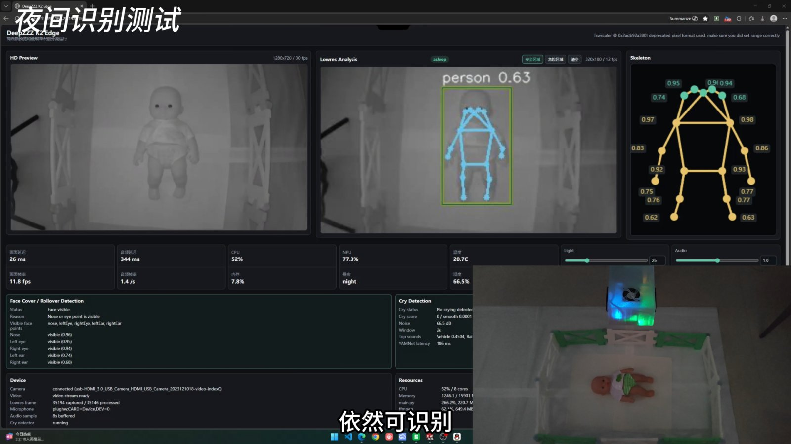

*图 10 夜间识别测试*

> **联动**：视觉告警和哭声告警走同一个告警流（联动①）；夜间画面依靠光敏传感器联动的 IR-CUT 和红外补光（联动⑥）；家长向大模型提问时，YOLO 暂停并保留最后一次结果，回答结束立即恢复（联动⑦）。

### 3.5 声音感知：听得见哭声

```text
USB 麦克风 → arecord 单路持续采集（16 kHz / 单声道）→ 8 s 环形缓冲
  ├─ YAMNet：每 0.5 s 取最近 2 s 窗口推理（CPU 2 线程）
  │     → 哭声分数 = 哭声类别（婴儿哭/啜泣/尖叫）逐帧最大值中前 3 帧的均值
  │     → 双阈值迟滞状态机 → 哭声告警 / 自动播放摇篮曲
  └─ /api/audio/live.pcm：同一路 PCM 实时共享给 ASR Worker 和 App 环境监听
```

**双阈值平滑算法**：分数 ≥ 0.45 时进入"哭闹"状态，并保持至少 2 秒；之后要连续 4 次（约 2 秒）低于 0.20 才退出。一声关门、一句电视对白这类短促声音不会触发告警，哭闹中途短暂停顿也不会让告警来回跳动。

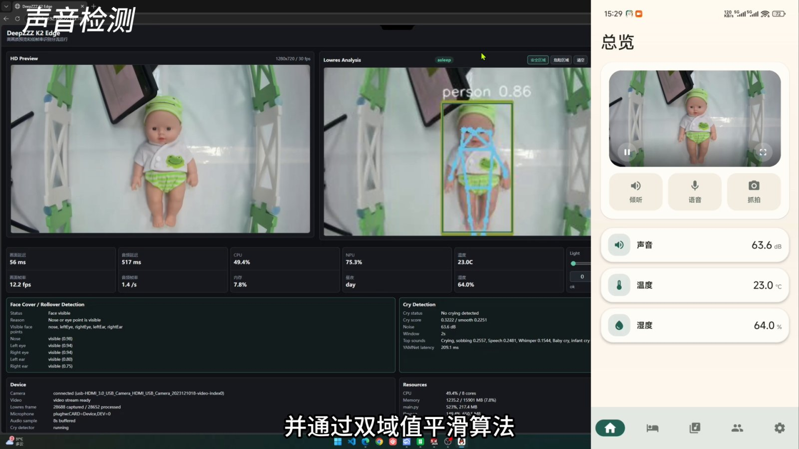

*图 11 声音检测*

**本地安抚**：板端内置摇篮曲曲库（上传、播放、暂停、拖动进度、音量），通过 USB 声卡以 48 kHz 立体声播放。App 中打开"哭声自动播放"后，检测到哭闹会自动开始播放，连续两次轮询确认哭声结束后才复位。家长对讲时，摇篮曲会自动让位，对讲结束后再恢复。

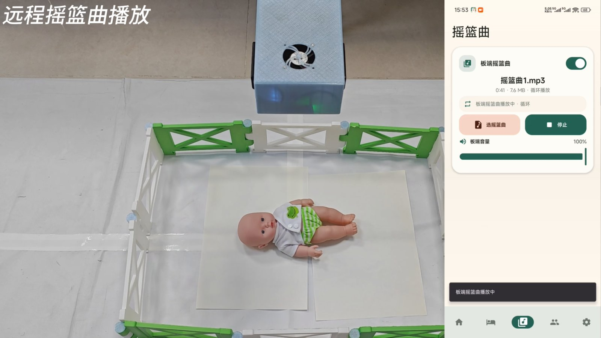

*图 12 哭声触发本地摇篮曲安抚*

> **联动**：同一路麦克风数据同时送给 ASR（联动③）；哭声可以触发摇篮曲（联动②）；大模型回答期间 YAMNet 不暂停，哭声检测不中断。

### 3.6 语音识别（ASR）：一句话记录

家长照顾宝宝时常常腾不开手。我们在板上实现了**语音育儿记录**：

```text
/api/audio/live.pcm（共享 PCM）
  → Silero VAD（512 采样点/窗，阈值 0.65，带迟滞）切出 0.5–5 s 的语音段
  → SenseVoice-Small int8（中/英/粤/日/韩，带逆文本正则化）
  → 意图解析：换尿布 / 喂养 / 入睡 / 睡醒
  → POST /api/care/records（来源标记为 voice）→ App「记录」页实时更新
```

- **不依赖原生编译**：特征提取（80 维 Kaldi fbank、LFR 拼帧、CMVN）和 CTC 解码全部用 numpy 实现，只需要板载自带的 onnxruntime，不用在 riscv64 上编译 sherpa-onnx、kaldi 等原生库。
- **语义理解**：内置 4 类、46 个口语关键词，并做了以下处理：
  - 否定与将来时过滤，如"不用换尿布""等会再喂奶"不记录；
  - 是非问句过滤，如"换尿布了吗"不记录，但"宝宝喂奶呢"这类陈述句照常记录；
  - 繁简统一，粤语转写的"換尿片"也能命中；
  - 从语句里抽取字段：奶量（"冲了一百二十毫升奶粉"→ 瓶喂、配方奶、120 ml）、时长（"左边亲喂了 15 分钟"→ 亲喂、左侧、15 分钟），尿布类型分湿、便、混合、干爽；
  - **拼音模糊匹配**：识别结果为"尿不时""为母乳"时，按声母/韵母/声调相似度纠正为"尿不湿""喂母乳"（阈值 0.9）。
- **合并去重**：10 分钟内重复提到换尿布、30 分钟内重复提到同类喂养，会合并成同一条记录；App 里已经手动记过的，语音不再重复记录；"睡着了/醒了"会自动开始和结束一段睡眠。

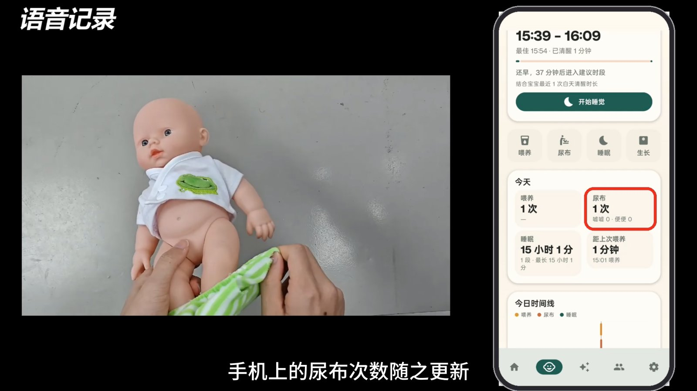

*图 13 语音育儿记录*

> **联动**：语音写入的记录，就是大模型回答问题时的上下文（联动④⑤）。在 3.2.2 节的回放中，"宝宝睡着了""宝宝醒了"两句话决定了大模型看到的"已睡 30 分钟"和小睡建议时间窗。

### 3.7 本地大模型（LLM）：育儿问答助手

App「AI 问答」页面的问题发送到板端，由板上 Ollama 运行的 **Qwen3-1.7B** 生成回答，并以流式方式逐字返回。

**设备上下文注入**：每次提问前，系统从育儿记录和传感器里组织一段上下文，与系统提示词一起交给模型：

- 宝宝档案：小名、性别、出生日期、月龄（精确到"0 个月 22 天"）；不满 3 个月时额外加入"发热立即就医"的安全提示；
- 今日记录：喂养次数、瓶喂总量、亲喂总时长，尿布次数（湿/便），累计睡眠时长；上次喂养和上次换尿布的时间；
- **小睡预测**：结合月龄对应的清醒时长范围（0 月龄 35–60 分钟 … 24 月龄 300–360 分钟）和该宝宝近 7 天白天的实际清醒间隔中位数（样本越多权重越高），给出建议的小睡时间窗；
- **摄像头与哭声观察**：摄像头当前画面（面部可见 / 疑似遮脸 / 疑似侧躺 / 画面无人），以及近 2 小时哭闹、遮脸/翻身、越界、离开画面的次数和最近一次的开始时间、持续时长（来自事件记录）；画面疑似遮脸或侧躺时，要求模型先提醒家长查看宝宝；
- 室内温湿度（只采用 10 分钟内的有效读数）。

**安全约束**：系统提示词要求简体中文、最多 3 句话、先给结论再给 1–2 条做法；不做诊断，不给药物剂量；遇到发热、呼吸困难、持续呕吐、精神差、抽搐等情况，提醒尽快就医或拨打 120。

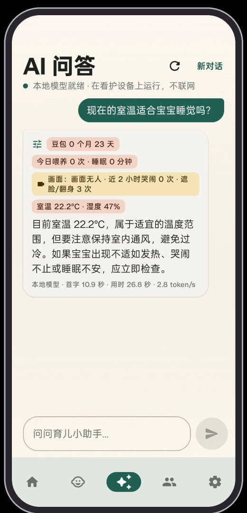

*图 14 AI 问答（回答卡片顶部的标签即注入的设备事实，黄色为视觉事实）*

> **联动**：上下文中的喂养、尿布、睡眠信息可以全部来自语音记录（联动⑤），画面状态和近 2 小时事件来自摄像头与哭声检测（联动⑩）；大模型生成回答时借用视觉和 ASR 的 AI 核（联动⑦）。

### 3.8 算力协同与端侧优化

3.2 节说明了三种能力之间的数据联动，本节说明它们如何在一块 8 核 RISC-V 板上**共享算力**（图 15）。

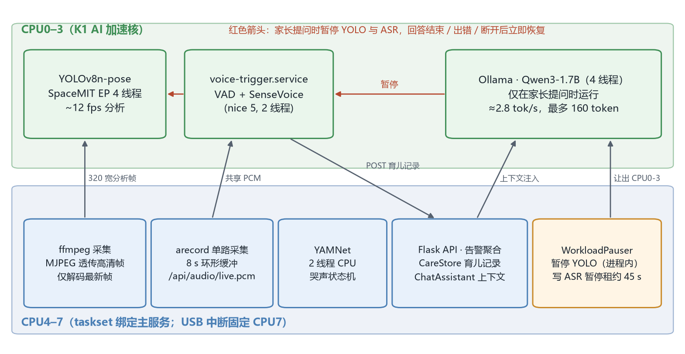

*图 15 算力协同与 CPU 资源分区*

**1）算力协同**

- **CPU 分区**：K1 的 AI 算力集中在 CPU0–3。YOLO 姿态推理（SpaceMIT EP，4 线程）和 ASR Worker 运行在 CPU0–3；主服务的其余线程（Flask、ffmpeg、YAMNet）绑定在 CPU4–7；USB 摄像头中断固定在 CPU7，避免抢占推理核。
- **按需让出算力**：大模型只在家长提问时运行。回答开始前，`WorkloadPauser` 在进程内暂停 YOLO（丢弃待处理帧、保留最后一次结果），并给 ASR Worker 写一份 45 s 的"暂停租约"（每 15 s 续约一次）。回答结束、出错或手机断开时立即恢复。主服务即使意外崩溃，租约到期后 ASR 也会自动恢复，不会一直停着。YAMNet 运行在 CPU4–7，不参与暂停，回答期间哭声告警照常产生。
- **事件采样不占 AI 核**：事件记录线程运行在主服务（CPU4–7），每秒只读取最近一次姿态和 YAMNet 结果，不做额外推理。
- **单路采集多方共享**：麦克风只由主服务的一个 arecord 进程打开，YAMNet、ASR Worker、App 环境监听都读这一路缓冲，避免多个进程抢占声卡设备。

**2）大模型端侧优化**

| 优化 | 做法 | 效果（板端实测/估算） |
| --- | --- | --- |
| 模型选择 | Qwen3-1.7B 为主，0.6B 备用 | 1.7B 回答质量明显好于 0.6B；板端实测首字 10.9–11.8 s、生成 2.8–2.9 token/s |
| 关闭思考链 | 自制 no-think 模板，强制空思考块 | 不输出冗长的推理过程，首个 token 更快出现 |
| 提示词缓存 | 修正旧模板系统提示词渲染两次的问题；上下文中固定内容在前、按分钟变化的内容在后 | 修正前每次提问额外多出约 30 s 的预填充时间 |
| 上下文长度 | `num_ctx=2048`（提示词约 300 token） | Ollama 默认 8192 需要约 900 MB KV 缓存，改后节省内存 |
| 常驻内存 | `keep_alive=30m` | 避免每次提问约 11 s 的模型重载 |
| 输出长度 | `max_tokens=160`，历史轮数 0 | 最长回答约 1 分钟，也避免小模型照抄上一轮回答 |
| 并发控制 | 单请求互斥（忙时返回提示）；手机断开即关闭上游连接，停止生成 | 避免排队和无效计算 |

### 3.9 交互端：App 与 Web 后台

**眠屿看护 App**（Kotlin + Jetpack Compose，Android 10 及以上）包含五个页面：

| 页面 | 功能 |
| --- | --- |
| 总览 | 实时画面、环境监听/对讲/抓拍、声音分贝、温度、湿度、最近告警；活动区域框选；摇篮曲播放与"哭声自动播放" |
| 记录 | 喂养/尿布/睡眠/生长一键记录，今日汇总，24 小时时间线，小睡建议时段，语音记录自动出现 |
| AI 问答 | 流式回答，显示本次参考的设备事实（含"画面：…"视觉标签），可随时停止；页面上的「设备观察」卡片显示当前画面、近 2 小时四类事件次数和最近事件 |
| 家人 | 家庭成员与邀请、成长相册 |
| 设置 | 板端连接、告警开关（遮脸/无人/哭声/越界）等 |

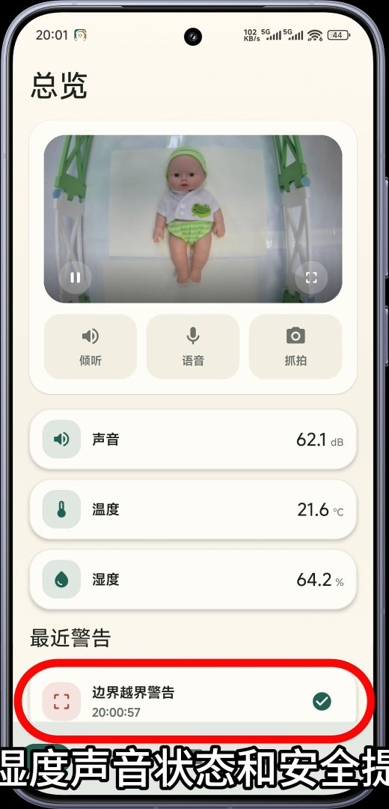

*图 16 App 总览页*

**Web 调试后台**（板端 `http://<板子IP>:7860`）同时显示高清预览、低清分析画面和骨骼关键点（含每个点的置信度），以及画面延迟、分析帧率、CPU/NPU/内存占用、昼夜状态、补光、哭声检测详情，方便调试和验证端侧算法（图 17）。

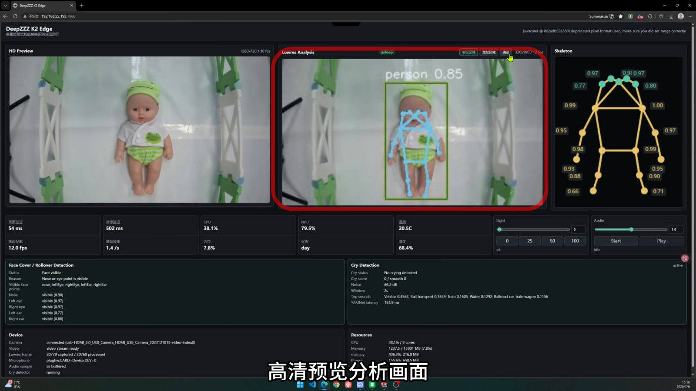

*图 17 Web 调试后台（演示视频实录）*

### 3.10 隐私与安全设计

- **数据不出家门**：视频帧只在内存中保留最新一帧，不录像、不切片、不上传（数据集采集只在手动触发时保存样本）；音频只保留 8 s 环形缓冲；语音段默认不落盘（`save_segments=false`）。
- **全离线推理**：CV、YAMNet、ASR、LLM 都在 K1 上运行，断网不影响任何核心功能。
- **故障隔离**：每个服务由 systemd 守护，异常退出 1–5 s 内自动拉起；状态文件原子写入，并标记更新时间，状态过期时网页显示"离线"，不会把旧数据当成当前状态。
- **医疗边界**：大模型不做诊断、不给药量，遇到危险症状一律提醒就医。

---

## 四、开发计划

### 4.1 已完成里程碑

| 时间 | 里程碑 |
| --- | --- |
| 2026.04 | K1 MUSE Pi Pro 上手，跑通官方模型库与 ROS 推理示例；确定"婴儿看护"选题 |
| 2026.05–06 | 硬件选型与夜视套件、供电模块设计打样；6 月 1 日完成姿态模型首次 K1 量化校准；6 月 15 日完成板端架构重建（`k1edge`：类型化配置 / 运行时外观层 / Flask 应用） |
| 2026.07 | 视觉安全规则（遮脸/翻身、越界）、YAMNet 哭声检测、App 总览与告警完成，录制第一版演示 |
| 2026.08 | K1 INT8 姿态模型 v2 上线；硬件 Worker 拆分为独立 systemd 服务；CPU 分区、USB 中断亲和性等性能优化；摇篮曲、对讲、环境监听 |
| 2026.11.03–05 | 新增 ASR（SenseVoice + Silero VAD）语音育儿记录、本地大模型 AI 问答（Ollama + Qwen3）；App 新增「记录」「AI 问答」页面 |
| 2026.11.07 | 板端代码定版导出；方案书、技术文档与开源仓库发布 |
| 2026.11.08 | 视觉/哭声事件记录与侧躺识别上线，事件摘要接入大模型上下文；App 新增「设备观察」卡片与视觉事实标签；完成最终演示视频 |

### 4.2 后续计划

| 阶段 | 时间 | 目标 |
| --- | --- | --- |
| 开源与复现 | 2026.11 | 代码与文档发布到 GitHub；补齐模型下载脚本与一键部署脚本；公开 ASR 实时率、大模型首字延迟等板端指标 |
| 语义理解升级 | 2026.12 | 关键词规则没有命中、但疑似育儿指令的语句，交给本地大模型做结构化意图解析（输出 JSON），规则与大模型互为兜底 |
| 语音交互闭环 | 2027.Q1 | 加入本地 TTS，语音提问直接语音回答；唤醒词 |
| 睡眠分析 | 2027.Q1 | 用视觉睡眠状态 + 语音/手动记录自动生成睡眠概览与周报 |
| 大模型加速 | 2027.Q2 | 评估 llama.cpp 针对 K1 RVV/IME 优化的推理后端，目标把 1.7B 生成速度提高到 2 倍以上 |
| 产品化 | 2027.Q2–Q3 | 外壳与供电整合、家庭多端同步（可选、加密）、扩大数据集并在更多真实家庭场景中验证 |

---

## 五、预期成果

### 5.1 交付成果

1. **可运行的软硬件原型**：K1 板端服务 + 夜视套件 + 宽压供电模块 + 3D 打印外壳；
2. **开源代码**：板端服务（Python 约 1.24 万行 + Web 前端约 2,300 行，含 105 个无硬件单元测试）、Android App 源码（Kotlin 约 9,000 行）、systemd 部署文件、模型量化/采集工具；
3. **技术文档**：优化策略、部署说明、用户文档、接口说明与测试报告（见《技术文档》）；
4. **演示视频**：固定机位实拍，含遮脸、翻身、越界、夜视、哭声、摇篮曲、语音记录、带视觉事实的 AI 问答、设备观察等场景讲解；
5. **婴幼儿姿态数据集与 K1 INT8 姿态模型**。

### 5.2 指标

| 指标 | 当前实测 | 目标 |
| --- | --- | --- |
| 姿态分析帧率（320×180） | ~12 fps | ≥ 12 fps，四模型并行时 ≥ 10 fps |
| 画面延迟（帧龄） | 24–89 ms（典型 54 ms） | < 100 ms |
| 危险告警到达手机 | 设计值 < 1 s（App 500 ms 轮询 + 分析周期约 83 ms + 帧龄约 54 ms） | < 1 s |
| 婴幼儿姿态 Top-1 / PCK@0.2 | 96.7% / 99.1% | 继续扩充数据集 |
| 哭声检测单次推理 | ~185 ms / 2 s 窗口 | < 200 ms |
| 整机资源 | CPU 38.1%，内存 1.24 GB / 15.9 GB | 四模型并行时内存 < 6 GB |
| 大模型首字 / 生成速度 | 首字 10.9–11.8 s，2.8–2.9 token/s（板端实测，Qwen3-1.7B） | ≥ 5 token/s（RVV/IME 加速后） |
| 看 + 听 → 事件 | 每秒采样；遮脸/翻身持续 2 s、离开画面 5 s 记为事件，哭声即时 | 保持 |
| 语音 → 记录 | 识别 56–149 ms/句，意图解析 + 写记录 ≤ 3.2 ms（PC 回放，2 线程） | 实时率 < 1，跟上说话速度 |
| 记录 → 大模型上下文 | 构造上下文 + 暂停/恢复视觉与 ASR：4–6 ms（PC 回放） | 保持毫秒级 |
| 离线可用 | 全部核心功能断网可用 | 保持 |

---

## 六、应用价值与市场潜力

### 6.1 应用价值

- **家庭**：从"人盯屏幕"变成"设备盯、人响应"。夜间高危状态主动提醒、先做安抚，家长能睡得更踏实；语音记录省去手动填写，问答助手结合宝宝当天的真实记录和摄像头、麦克风的观察给出建议，减轻新手父母的焦虑。
- **安全**：遮脸、趴睡、越界是婴儿睡眠安全的重点关注项。系统把这些状态变成可解释的关键点规则和即时告警，弥补人力照看的空档。
- **隐私**：婴儿画面属于高度敏感数据。纯端侧方案从架构上消除了云端泄露的风险，也免去了订阅费用和对网络的依赖。
- **技术示范**：在国产 RISC-V AI 芯片上，用一块板实现了 CV + ASR + LLM 的三条联动闭环（安全、认知、算力），并给出了共享采集、事件记录、共享记录库、CPU 分区、租约暂停、提示词缓存等可复用的工程方法，可以为 K1 生态中的其他端侧多模态应用提供参考。

### 6.2 市场潜力

- **目标用户**：0–3 岁婴幼儿家庭（尤其是双职工、新手父母、隔代照看家庭），以及月子中心、托育机构等需要同时照看多名婴儿的场所。
- **产品形态**：一台本地 AI 看护终端 + 免费 App。硬件一次性购买，无需订阅；可以按场景扩展为托育机构的多路看护版本。
- **差异化**：和"联网摄像头 + 云端订阅"的主流方案相比，本方案在隐私、断网可用、告警准确率和"能干预、会记录、会回答"的完整闭环上有明显优势；采用国产 RISC-V 芯片，有利于控制成本和供应链自主。
- **延展方向**：同一套"端侧视觉 + 声音 + 语音 + 大模型"的技术底座，可以迁移到居家养老（跌倒、离床、夜间异常声音）、病房陪护等看护场景。

---

## 七、附录

### 附录 A 开源代码

- **GitHub 仓库**：https://github.com/FAKER798/DeepZZZ
- 获取代码：`git clone https://github.com/FAKER798/DeepZZZ.git`
- 仓库结构：

```text
DeepZZZ/
├── K1/                       # 板端服务（本次导出的 K1_board_export_20261107）
│   ├── main.py               # 入口
│   ├── k1edge/               # 配置、运行时、Flask 应用、状态存储
│   ├── ai/                   # pose / vision_ai / audio_ai / asr / low_light / runtime(EP)
│   ├── pipelines/            # 视频、音频流水线
│   ├── services/             # 育儿记录、事件记录、AI 问答、语音记录、活动区域、数据集采集
│   ├── devices/              # 摄像头、麦克风、PWM、DHT11、IR-CUT、昼夜
│   ├── web/                  # 调试后台前端
│   ├── scripts/              # systemd 单元、模型安装、基准测试
│   ├── tests/                # 105 个无硬件单元测试
│   ├── .brdk_models/pose/    # K1 INT8 姿态模型（3.6 MB）
│   └── models/yamnet/        # YAMNet 模型与标签
├── app/naviga/               # 眠屿看护 Android App 源码
└── docs/                     # 方案书、技术文档（Markdown）及配图
```

### 附录 B 演示视频

- 文件：`7月6日-最终版3.mp4`（4 分 06 秒，3840×2160）
- 内容：项目背景 → 硬件组成 → 系统架构 → App 与 Web 后台 → 婴幼儿姿态数据优化 → 遮脸检测 → 翻身检测 → 危险区域检测 → 夜间识别 → 哭声检测 → 摇篮曲与环境监听/对讲 → 睡眠概览/家人/成长相册 → 育儿记录 → 语音记录 → AI 问答（带视觉事实，2:58） → 设备观察（3:13） → 总结

### 附录 C 主要接口一览

| 类别 | 接口 |
| --- | --- |
| 状态 | `GET /api/healthz`、`GET /api/status`、`GET /api/alerts` |
| 视觉 | `GET /api/preview-snapshot`、`GET /api/snapshot`、`GET /api/detections`、`GET /api/vision/safety`、`GET/POST/DELETE /api/activity-zone` |
| 音频 | `GET /api/audio/live.pcm`、`POST /api/audio/yamnet`、`/api/lullabies/*`、`/api/audio/talk/*`、`/api/audio/playback/*` |
| 育儿记录 | `GET/POST /api/care/records`、`PUT/DELETE /api/care/records/<id>`、`POST /api/care/sleep/end`、`GET /api/care/overview`、`GET/PUT /api/care/profile` |
| 语音记录 | `GET/POST /api/voice-trigger` |
| 视觉/声音事件 | `GET /api/events`、`GET /api/events/summary`（详见《接口文档》） |
| AI 问答 | `GET /api/assistant/status`、`POST /api/assistant/chat`（NDJSON 流式） |
| 硬件 | `GET/POST /api/light`、`GET /api/temperature-humidity` |

完整说明见《技术文档》第 6 章。

### 附录 D 主要模型清单

| 模型 | 文件 | 大小 | 运行位置 |
| --- | --- | --- | --- |
| 婴幼儿姿态 | `yolov8n-pose-k1-320-int8.onnx` | 3.6 MB | SpaceMIT EP（CPU0–3） |
| 声音事件 | `yamnet.onnx` + 521 类标签 | 16.1 MB | CPU（2 线程） |
| 语音识别 | SenseVoice-Small `model.int8.onnx` | 239 MB | CPU0–3（voice-trigger） |
| 语音活动检测 | `silero_vad.onnx` | 0.6 MB | CPU0–3 |
| 大语言模型 | Ollama `qwen3-1.7b-nothink`（备用 `qwen3-0.6b-nothink`） | Ollama 默认量化 | CPU0–3（4 线程） |

### 参考资料

[1] 国家统计局.《中华人民共和国 2024 年国民经济和社会发展统计公报》.

[2] 影响受访者生育意愿的原因调查（演示视频 0:05 处引用，原始出处由团队补充）.

[3] SpacemiT. YOLOv8 训练部署全流程（模型训练、xquant 量化、K1 推理）. 见仓库 `official_yolov8_pipeline.md`.

[4] Gemmeke J F, et al. Audio Set: An ontology and human-labeled dataset for audio events. ICASSP 2017.（YAMNet 训练数据）

[5] FunAudioLLM. SenseVoice: Multilingual Speech Understanding Model; k2-fsa sherpa-onnx 导出版本.

[6] Qwen Team. Qwen3 Technical Report, 2025.
